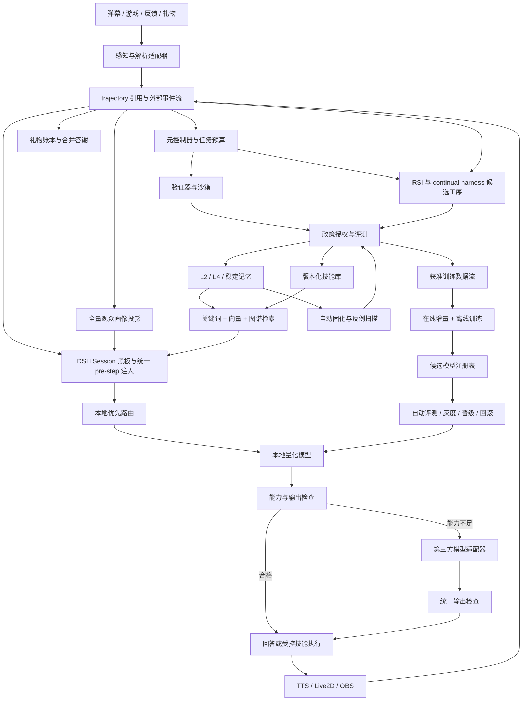

# DSH 大肥鱼自学习直播全量实现方案

版本：v4.0  
更新日期：2026-11-11（Asia/Shanghai）  
部署硬件：RTX 4060 Ti 8GB 显存，32GB 系统内存。  
文档用途：本期完整开发范围、接口设计、运行策略和验收标准。文中参数为待实机校准的初值，不代表已完成运行验证。

## 1. 本期目标与完整范围

构建本地模型优先、第三方大模型兜底的自学习直播系统。会话与长期记忆在本地保存，通过技能库执行可复用流程，并持续从真实反馈中改进模型和记忆。

**本期完整交付以下能力，不再作为后续可选项：**

| 模块 | 本期交付 |
| --- | --- |
| 本地优先推理 | 量化模型服务、能力判定、质量检查、超时和第三方兜底 |
| 统一记忆 | 会话、短期状态、L2 可学习认知、L4 经验证据、版本与冲突处理 |
| 全量观众画像 | 全部可观测且符合用途条件的互动观众建档、增量更新、分群、个性化、查看纠错与删除 |
| 技能库 | 技能包、检索、参数契约、受控执行、测试、自动版本发布与撤回 |
| 向量与图谱优化 | 关键词、真实 embedding、关系图谱三路检索，融合、重排、评测与索引迁移 |
| 在线模型训练 | 直播期间基于新反馈执行真实增量参数更新，资源调度、回放与检查点恢复 |
| 离线训练 | 下播后批量训练、重建、导出及完整评测 |
| 自动发布 | 自动验证、灰度分配、监测、晋级、熔断与回滚 |
| 自动固化 | 经验证知识与行为进入可撤回的稳定记忆，支持 L1/L3 学习命名空间 |
| 感知与黑板 | 统一事件解析、DSH Session 投影、带来源和 TTL 的工作记忆 |
| 持续学习编排 | orchestrator、受限 subagent、验证器及 continual-harness 复盘闭环 |
| 反馈与打赏 | 反馈归因、纠错、礼物幂等账本、答谢、退款冲正和防刷 |
| 一键操作与文档 | 首次配置向导、开播/训练入口、状态解释、恢复操作和随版本发布的说明 |
| 运维与治理 | 统一授权、审计、数据用途控制、预算、备份恢复及 AI 标识检查 |

本期按依赖顺序分批开发和启用，但交付完成必须覆盖全部模块。只保存开关、注册空接口、生成候选而不执行训练/发布/固化，均不算完成。

自动化权限由独立政策服务执行。直播模型可以提出内容、选择技能和请求操作，但不能给自己签发写入、发布或权限扩张凭证。日常合格任务自动流转；人设身份修改、用途变更、代码技能权限扩张及无法自动裁定的冲突保留管理入口。

## 2. 组件与系统架构

### 2.1 组件划分与能力映射

所有模块本期交付，用户只安装和操作一个 `dsh-dafeiyu-evolve` 产品入口。内部插件由固定版本的安装清单管理，不要求用户逐个填写参数。

| 能力 | 绑定组件 | 本项目交付契约 |
| --- | --- | --- |
| 感知/解析 | DSH 模型适配器、本地优先的 LLM、直播事件桥 | `PerceptionAdapter`：规范化事件、结构化意图、来源与解析置信状态 |
| 工作记忆（黑板） | DSH Session 与统一 pre-step 注入器 | `BlackboardStore`：场次状态、任务、版本和 TTL，冲突受控更新 |
| 语义记忆 | `dsh-rsi` Chat Memory + `dsh-plugin-neural-cloud` 检索投影 | `MemoryAdapter`：治理账本为生效依据，检索索引可重建；统一用途与作用域 |
| 情景记忆 | DSH 原生 trajectory + 外部直播事件桥 | `TrajectoryAdapter`：可追踪、可回放且不重复执行动作 |
| 技能库 | `dsh-rsi` Skill Provider | `SkillRegistry`：SKILL.md、资源、版本、权限、测试与可撤回发布 |
| 元控制器 | 自定义 orchestrator，可调用受限 DSH subagent | `LearningOrchestrator`：回答、检索、推演、复盘、训练的预算化决策 |
| 验证器 | 自定义规则/测试工具插件 | `Verifier`：结构、来源、内容、沙箱、回归和发布检查 |
| 持续学习闭环 | `dsh-continual-harness` 适配器 + 发布控制器 | `ContinualAdapter`：复盘提案、隔离验证、联合发布及真实回滚 |
| 直播 | `dsh-live-studio` 与抖音平台适配器 | 弹幕、反馈、礼物、TTS、角色、推流和平台状态回执 |
| 模型训练 | 本地模型服务 + 独立 Python worker | 本地推理、在线分时 QLoRA、离线训练、候选产物与恢复 |
| 持久化 | SQLite、插件数据目录、不可变产物目录 | 治理账本、观众画像、索引元数据、操作日志和备份 |

治理账本记录逻辑对象 ID、来源、授权、生效版本和后端映射；正文通过 MemoryAdapter 存取，已发布内容保留不可变快照。neural-cloud 保存可重建检索投影，不成为第二套独立学习真相。既有 `dsh-Immunity-memory` 数据通过迁移适配器导入或保留为兼容后端；同一逻辑对象仅指定一个主后端，禁止多插件各自自动抽取、固化和注入。

**DSH 接口以锁定版本为准。** `dsh-rsi` 当前文档描述的是单用户记忆及 Skill 演进；其 L0—L3 分别表示原始对话、原子记忆、主题/项目场景和长期画像，与本文人格治理层不同。本文 L2/L4 等是项目逻辑层，适配器按语义映射，不能直接用同名编号写后端；多观众画像由独立表管理。[dsh-rsi 接入说明](https://github.com/lsmax-72/dsh-rsi/blob/main/README.md)

neural-cloud 提供本地引擎、记忆工具、多通道召回和溯源；默认无向量服务时可能使用哈希向量。本项目指定真实本地 embedding，并关闭其独立自动抽取与直接提示词注入，所有写入和上下文装配通过治理入口。其引擎依赖 Java 17+，端点限定回环地址；不得因“本地引擎”就推定所有模型请求也在本地。[neural-cloud 接入说明](https://github.com/mike1-huh/dsh-plugin-neural-cloud/blob/main/README.md)

安装器输出 `compatibility-lock.json`，固定宿主/插件 SHA、构建产物哈希、Node/Java/Python/CUDA 版本、schema、许可证清单及验证结果。当前文档中 RSI 与 continual-harness 的宿主版本范围交集包含 `0.2.0-rc.2`，它只作为集成候选，不能代表直播栈已经兼容。RSI 当前采用源码构建接入；安装器提供经验证产物，不假设存在可直接安装的同名 npm 包。组合测试不通过时修复适配层或锁定兼容版本，不让用户自行试装“最新版”。

### 2.2 架构图



输出检查不能把第三方失败重新送入无限循环。每个逻辑请求绑定总预算、最多一次第三方生成和有限技能步骤；模型生成、工具执行与播出状态分别记录。

### 2.3 真实直播接入点

在 Python 直播聊天模块发起模型请求的位置接入统一路由，替换固定第三方调用；生成后和实际播放后分别提交事件。现有服务端与聊天模块的接入位置参考[直播服务端](https://github.com/XiaoZheBrother/dsh-live-studio/blob/main/backend/live-pilot-server.py)和[聊天模块](https://github.com/XiaoZheBrother/dsh-live-studio/blob/main/backend/live_pilot_chat.py)。

若运行路径使用 DSH Agent，则使用锁定版本的会话事件和上下文契约。`turn/end` 按持久会话事件处理，`agent/pre-step` 按 waterfall 接口处理，不假定 payload 存在 `step.inject()`。同一回复只允许一个采集器和一个学习上下文注入器。[DSH 契约](https://github.com/deepseek-ai/deepseek-harness/blob/master/docs/subsystems/core.zh.md)

启动时验证宿主、直播插件、记忆插件的 commit SHA、依赖、工具清单、管理入口和模型模板，生成兼容矩阵。

### 2.4 感知、事件与黑板契约

弹幕、礼物、管理员操作、工具、TTS 和平台回执先走确定性解析；只有需要判断语义时才调用本地模型。模型支持文本、结构化输出、工具调用或图像的能力在注册时探测，不能把“任意 LLM”视为支持所有模态。游戏优先读取授权的结构化状态；图像仅按事件触发采样，无多模态模型时降级为 OCR/状态工具，禁止持续截图逐帧请求大模型。

```typescript
// 项目接口，具体 DSH 事件绑定由适配器实现。
interface LiveEnvelope {
  schemaVersion: number
  eventId: string
  source: string
  sourceEventId: string
  roomId: string
  sessionId: string
  viewerKey?: string
  occurredAt: string
  receivedAt: string
  type: string
  correlationId?: string
  causalEventIds: string[]
  provenance: 'platform_verified' | 'operator' | 'bridge' | 'unverified'
  purposeTags: string[]
  payloadRef: string
}
interface BlackboardSnapshot {
  revision: number
  sessionId: string
  topic: string
  gameStateRef?: string
  pendingTasks: string[]
  recentEventIds: string[]
  activeReleaseId: string
  policyVersion: string
  expiresAt: string
}
```

黑板按角色/场次隔离，保存任务状态和事实引用，不保存模型隐式推理。写入使用 revision 比较与交换；过期游戏状态不可继续驱动动作。pre-step 仅装配已授权快照、记忆和技能，统一 token 预算，回合结束提交投影。画像内容带观众作用域，不因进入同一 Session 就变成全场共享事实。

DSH 原生 trajectory 用于宿主已记录的会话/工具轨迹；Python 直播管线、OBS、礼物等外部事件必须经桥接记录，并关联原生 session/event ID。原生轨迹保留引用和消费游标，避免重复保存正文。缺失平台事件明确显示“不支持/未知”，不能伪造或声称已完整采集。

事件回放使用 `replay=true` 的只读执行环境，禁止推流、播音、游戏操作和再次答谢。断点恢复按来源唯一键去重；时间乱序采用接收游标和有界迟到窗口，补到事件可以更新投影，但不能重放已完成动作。

## 3. 8GB 显存部署与资源管理

### 3.1 模型及进程配置

本地基础回答模型优先验证 `Qwen/Qwen3-4B-Instruct-2507` 的 Q4_K_M 量化产物。该模型为非思考模式，具体中文直播质量、工具格式与延迟需在目标设备验收。[官方模型卡](https://huggingface.co/Qwen/Qwen3-4B-Instruct-2507)

在线学习提供两种独立模型配置：

- `main-4b`：4B 基础模型及其专属 LoRA，资源允许时对该模型在线增量训练。
- `online-1.7b`：`Qwen/Qwen3-1.7B` 及其专属 LoRA，用于 4B 在线训练无法满足资源预算时的较小模型路径，推理关闭思考模式。它必须独立通过质量门槛才能成为线上回答模型。[官方模型卡](https://huggingface.co/Qwen/Qwen3-1.7B)

两种模型的 adapter 不互换；每次发布绑定精确 base revision、tokenizer、模板和量化产物。仅训练出 1.7B adapter 不能声称已更新 4B 模型。初次验收选择可运行的配置并固定，不按每条弹幕临时下载或切换模型。

| 资源 | 起始设置 |
| --- | --- |
| 常规 GPU 推理 | 单模型、单生成并发，上下文 4096 token，最大输出 128 token |
| GPU 训练 | 单 worker、micro batch 1、短序列、仅 LoRA 参数更新 |
| 本地 CPU 接答 | 预热同一稳定版本的量化推理实例，在线训练窗口内优先接答 |
| embedding | CPU 常驻一个小型模型，批处理离线文档；查询向量单独设置时限 |
| 图谱与索引 | CPU 运行；构建、压缩和备份受限速控制 |
| TTS / OBS / 游戏 | 预留实测资源预算，训练不得占用其必要显存 |
| RAM | 同时统计所有进程 RSS、文件映射和缓存，限制峰值并保留系统余量 |

4B 的 4-bit 权重理论量级约 2GB，实际还包含量化元数据、KV cache 和计算缓冲。预留约 1GB 显存仅是起始预算目标，必须按游戏、画面与语音的实测峰值调整。

### 3.2 资源仲裁器

每秒采集显存、RAM、推理队列、首声延迟、GPU 利用率和进程存活状态。按以下优先级分配资源：

```text
播出及安全操作 > 实时本地回答 > 反馈纠错与复盘 > 获准的后台任务
```

训练前检查 `free_vram >= measured_training_peak + reserve`，同时检查 CPU 回答延迟、RAM 和云端预算。资源不满足时延期当前训练窗口并记录原因；不得通过杀死直播进程释放资源。

8GB 设备不承诺 4B GPU 推理和 4B GPU 训练同时驻留。采用分时调度：训练时临时卸载 GPU 推理权重，由本地 CPU 量化实例优先接答，超时按既定政策升级第三方；训练后释放显存并预热稳定 GPU 推理版本。

如果目标游戏负载使所有训练窗口均不可用，应尝试较小在线模型配置并重新验证质量。仍无法在直播期间完成参数更新，则该硬件/负载组合的在线训练验收不通过，不能把任务推迟到下播后再标记为在线训练完成。

## 4. 本地优先路由与第三方兜底

### 4.1 请求路径

```text
输入与政策检查
→ 会话摘要 + 当前观众画像的必要字段 + 已审记忆 + 技能检索
→ 可用本地实例：GPU 优先，训练窗口使用 CPU
→ 生成候选 / 技能计划
→ schema、证据、任务完成度、人设和重复检查
  ├─ 合格：回答或执行技能，再检查真实结果
  ├─ 能力不足：允许出域的最小上下文 → 第三方 → 同一检查链路
  ├─ 缺少必要参数：澄清或暂缓
  └─ 政策阻断或全部失败：固定降级回复 / 人工接管
→ 本地记录请求、选择结果、工具回执和实际播出
```

所有常规任务先尝试本地模型。端点不可用、资源不足、已确认缺少必要模态时允许跳过无效调用，但必须记录具体原因。模型自评置信度不直接决定升级。

| 原因码 | 判定 | 处理 |
| --- | --- | --- |
| `LOCAL_UNAVAILABLE` | GPU/CPU 服务不可用或未就绪 | 第三方可用性和预算检查 |
| `LOCAL_RESOURCE_UNAVAILABLE` | 超出资源/排队预算 | CPU 本地尝试，随后兜底 |
| `LOCAL_TIMEOUT` | 完整候选超出共享时限 | 取消并丢弃迟到输出，按剩余时间兜底 |
| `UNSUPPORTED_CAPABILITY` | 模态或输出契约不支持 | 路由到具备能力的已注册模型/工具 |
| `SCHEMA_INVALID` | 格式或参数校验失败 | 总预算内最多修复一次，再兜底 |
| `EVIDENCE_INSUFFICIENT` | 来源缺失、冲突、过期 | 先受控查询，仍不足则升级或明确无法确定 |
| `QUALITY_GATE_FAILED` | 跑题、重复、任务未完成 | 第三方一次尝试并复检 |
| `NEEDS_CLARIFICATION` | 用户目标或游戏状态缺失 | 澄清，不自动猜测 |
| `POLICY_BLOCKED` | 越权、身份欺骗等硬性违反 | 阻断，不以第三方绕过 |

### 4.2 时限与执行次数

初始本地候选预算 5 秒，总实时决策预算 12 秒，其中约 1.5 秒预留给检查及提交播出。检索、CPU 尝试、本地修复、技能执行及第三方请求共享预算；不同阶段不能各自重新获得完整超时。

每个逻辑请求最多一次第三方生成、两个技能步骤。第三方已调用后，工具结果由本地模型或审核模板形成短答；仍无法完成则进入异步任务，不循环消耗直播时延。

首版完整短回复通过检查后再送 TTS，固定等候语单独记账。以 `request_id + generation_epoch` 防止迟到本地结果和云端结果重复播出。动作具有幂等键，已执行动作不得因模型升级重做。

### 4.3 出域与记忆连续

本地会话日志是唯一真源。第三方只接收当前问题、必要摘要、允许出域的记忆/技能及已完成动作回执，不上传完整观众档案或整库。

数据字段使用 `local_only / cloud_allowed`，出域用途由服务端检查；凭据由适配器持有，模型无法访问。不能出域的信息继续本地处理或暂缓，不把脱敏失败视为允许上传。

第三方结果保存在本地并标明来源、验证状态与实际选用结果。固定人设和必要事实在两类模型之间保持一致；供应商会话 ID 和 KV cache 不承担持久记忆职责。

## 5. 记忆分层、L2 学习与冲突处理

### 5.1 分层与命名空间

| 数据域 | 内容 | 写入与采用规则 |
| --- | --- | --- |
| `persona_core`：L0/L1/L3 | 身份、价值观、AI 标识、不可协商边界 | 固定只读版本；自动学习与固化无写权限 |
| L2 | 可修订的判断、偏好假设、场景理解、短期策略认知 | 本期启用自动候选、验证、限时写入、冲突和撤销 |
| L4 | 经验证经历、表达经验、游戏证据和操作教训 | 自动授权后写入，显式 TTL、来源和作用域 |
| `learned_stable`：L1/L3 | 自动固化的稳定认知/行为方法 | 独立于人格内核，可版本化、到期复核与反例撤回 |
| 观众画像 | 观众相关事实、偏好、互动关系和聚合特征 | 专门存储与用途权限，不混入人格内核 |
| 工作记忆 | 当前话题、未完成任务和实时游戏状态 | 有限窗口和摘要，按场次管理 |

本表为项目治理逻辑层。RSI 的原生 L2/L3、neural-cloud 的 tier 与本表没有数字等价关系；`layer-map.json` 记录逻辑域到物理对象类型的映射、权限及迁移版本。核心人设以独立只读签名资源加载，不依赖后端原生编号保护。

模板切换不替代数据隔离。读写必须限定 `workspace / character_id / namespace / domain`，并在向量、图谱、缓存、导出及恢复路径执行相同过滤。

### 5.2 L2 条目模型

```yaml
id: cognition.game_pacing.001
revision: 1
layer: L2
namespace: evolving_cognition
claim: 当前这类种田片段适合先简短回应催促，再说明下一步动作
kind: hypothesis
scope:
  character: dafeiyu
  scene: farming_chat
supportingEvidence: [event_001, event_019]
counterEvidence: []
status: proposed
validFrom: generated_at_write
ttlDays: 7
reviewAfterDays: 2
confidenceSource: calibrated_evidence_policy
```

L2 状态为 `proposed → validated → active → challenged / expired / superseded`。允许自动写入通过政策的场景假设，但在检索输出中显式标为假设，不伪装确定事实。初始 TTL 7 天、两天复核；证据不足不续期。

至少记录两个独立证据事件才能进入自动验证，去重簇、同一账号刷屏和模型复述不算独立证据。该数量只是最小采样门槛，仍需来源与语义校验。用户直接提供的明确事实按相应来源类别处理，不强制凑足重复证据。

对新条目查找相同主体、属性、时间范围及场景的矛盾。存在实质冲突时双方保持版本，标记 `challenged`，检索不把任何一方呈现为确定事实；可由新权威证据自动裁决，无法裁决时进入例外队列。

L2 可以影响短期表达和场景判断，不能修改权限、人设身份或把对观众的猜测提升为人格属性。L2 到 L4 或稳定层的转移必须保留全部来源、适用范围及反例。

### 5.3 事实与训练分离

保存回复不等于确认回复中的事实。回答、工具回执和播出记录先进入事件库，再提取记忆候选。个人信息、动态时间事实和需要可靠删除的数据不写入模型参数。

模型切换或重启时从事件与已审摘要重建工作记忆。记忆过期在查询时立即生效，不依赖后台清理。模型训练样本被撤销后，按血缘定位受影响产物并停止部署，必要时从清洁数据重训。

## 6. 全量观众画像机制

### 6.1 覆盖范围与身份

“全量”指对目标平台已授权接口可观测、允许处理的互动观众和事件实现完整采集、更新与服务，不只抽样高活跃或送礼用户。平台不提供的观看身份、停留时间等字段记录为未知，不能伪造为已获取。

身份键为 `platform + room_scope + platform_user_id`，内部使用带密钥的伪名化 ID。昵称变化不创建新身份；不同平台的同名账号不自动合并。跨平台关联只有在可验证的账号绑定和相应用途条件下建立。

匿名观看者只参与平台提供的聚合统计；不能从头像、昵称或语言猜测真实身份、敏感属性或线下关系。

### 6.2 完整字段体系

| 画像域 | 字段及来源 |
| --- | --- |
| 基本资料 | 平台 ID 引用、显示昵称、首次/最近可观测互动时间、资料更新时间 |
| 互动行为 | 弹幕数量、去重互动次数、回复参与、话题、时间段、频率、互动间隔 |
| 兴趣与偏好 | 明确表达的游戏/话题偏好、称呼、语言风格、禁忌话题；推测偏好与明确偏好分开 |
| 关系与记忆 | 已确认共同经历、已答问题、未解决请求、观众主动授权的长期约定 |
| 反馈 | 满意/不满、纠错、明确投诉、内容相关性及对应证据 |
| 支持行为 | 平台可用的关注、会员、礼物事件与统计；区分标价、实际结算及不可用字段 |
| 运行管理 | 去重/限频信号、事件来源可信度；限制行为记录具体事件，不产生人格标签 |
| 权利与用途 | 告知版本、适用处理依据、个性化开关、出域/训练许可、保留期、删除状态 |

不从礼物推断收入或支付能力，不生成政治倾向、宗教、健康、性取向等敏感推断。画像用于相关性、连续互动和服务体验，不用来操纵情绪或差别化索取打赏。

### 6.3 处理链路

```text
平台事件接入
→ 身份与用途检查
→ event_id 去重 / 迟到事件处理
→ 事实字段与聚合特征更新
→ 偏好候选提取与来源验证
→ 画像版本更新
→ 受控画像检索
→ 选取当前回复必要的少量字段
→ 个性化回复与效果记录
```

每个字段保存 `value / source_event_ids / observed_at / confidence_kind / expires_at / purpose`。统计字段采用可重放聚合，迟到事件按事件时间更新；偏好采用随时间衰减的分数，允许观众明确纠正直接覆盖推测值并保留审计。

先用确定性规则更新计数和明确偏好，再使用本地模型提出复杂偏好候选。模型判断不能直接改变封禁、付款、权益或其他重大决定。后台分群支持活跃度、内容兴趣和互动新老程度，分群归属随时间变化，不是永久身份标签。

### 6.4 可管理性与个人信息生命周期

提供运营查看、字段来源、观众查看/纠错/删除、关闭个性化、导出和保留期管理。自助请求需要验证账号归属；未完成身份验证不返回他人画像。停用个性化后仍可按必要范围维护服务与安全事件，但不继续用于个性化推荐。

建议原始互动片段保留 7 天、训练候选证据 30 天、非活跃画像 90 天后清理或重新确认用途；这些是可配置工程初值。画像原文默认 local-only，默认不进入模型训练。内容公开可见不自动代表允许所有后续用途。

删除通过事务 outbox 传播到画像、缓存、向量、图谱、训练候选和备份恢复墓碑；恢复备份必须重新应用删除记录。审计保留最小无原文记录，并报告传播状态。不可把伪名化称为匿名化。

上线前按实际运营场景确定个人信息处理依据、告知、个性化拒绝和必要的影响评估；相关自动化决策与个人权利要求参考[《个人信息保护法》官方原文](https://www.cac.gov.cn/2021-08/20/c_1631050028355286.htm)。

## 7. 技能库与受控执行

### 7.1 技能包

`dsh-rsi` Skill Provider 对外提供已发布技能的发现和按需加载；本项目将其生成结果导入 staging。Git 保存技能正文、代码与测试，SQLite 保存版本索引、决策和执行记录。记忆后端仅保存技能摘要与 `skill_id + version + hash` 引用。

```text
skills/<skill-id>/<version>/
├── SKILL.md
├── manifest.yaml
├── input.schema.json
├── output.schema.json
├── examples.jsonl
├── tests.jsonl
└── runtime/                 # 可选受控执行代码
```

技能类型包括表达、只读查询、游戏/角色动作和离线复盘。每个 manifest 包含触发条件、前置条件、输入输出、允许工具、权限、超时、幂等、后置条件、fallback、冷却和内容哈希。

### 7.2 选择与执行

按角色、场景、游戏版本、当前发布清单过滤技能，再检索摘要。模型输出 `skill_id / version / arguments`，执行器验证版本、schema、权限、来源和前置状态后执行。

执行后用真实工具回执验证后置条件，记录 `retrieved / selected / executed / succeeded / played`。失败使用技能定义的 fallback，禁止编造成功。模型只能请求工具，工具调用格式支持情况需按具体模型及模板验证。[工具调用参考](https://docs.ollama.com/capabilities/tool-calling)

新表达和只读技能可在通过测试后自动发布；现有代码技能在不扩大权限的前提下，经静态检查、沙箱测试和回归后自动发布。新增任意代码执行面、网络目的地或文件写权限进入管理审核，不能由模型自己扩权。

技能生命周期为 `draft → validated → staged → canary → active → suspended / superseded`。版本不可原地覆盖，撤销技能在执行前实时检查，模型参数中记得旧技能名不构成执行授权。

## 8. 向量、图谱与检索效果优化

### 8.1 三路召回

本期实现关键词、真实语义 embedding 和图谱三路召回，不以哈希向量替代语义模型验收。embedding 优先验证 CPU 部署的 `Qwen3-Embedding-0.6B`，根据实测 RAM/时延固定模型、维度、归一化和查询指令；所有查询与文档采用匹配的版本。[官方模型卡](https://huggingface.co/Qwen/Qwen3-Embedding-0.6B)

生产检索通过 neural-cloud 适配器接收已发布条目和本地 embedding，复用其向量及图关系能力；元数据、权限与反例血缘保存在 SQLite。需要的版本、过滤或图遍历契约缺失时，本期补齐适配实现。CPU 版 [FAISS](https://github.com/facebookresearch/faiss) 可作为适配器内部索引实现，但同一分区只启用一个向量引擎，避免重复驻留和双写。切换实现通过索引 generation 迁移，必须执行统一评测与过滤。

```text
权限 / 作用域 / 发布时间 / TTL 过滤
→ BM25 top-20 + vector top-20 + graph top-20
→ 统一 ID 去重 + RRF 融合
→ 场景、证据质量、冲突、冷却及多样性重排
→ 重新验证当前授权与撤销状态
→ 记忆 top-3 + 技能 top-2 + 画像必要字段
→ 总上下文预算截断
```

向量库不支持前置过滤时，应在授权分区内查询或采用严格候选过滤与扩大召回策略；未通过 ACL 的正文不能送到模型或日志展示。图谱遍历每一跳校验作用域，不能用一条合法边带出另一个观众的私有资料。

### 8.2 图谱结构

节点包括 `memory / skill / scene / game / event / viewer_profile / claim`。边包括 `supports / contradicts / derived_from / supersedes / applies_to / used_in / preference_for`。

每条边保存来源、关系类型、权重、时间范围、提取器版本和复核状态。由模型提出的边先入候选，确定性验证通过才进入生产图谱；图谱关联不是因果证明。默认最大两跳、最多 50 个扩展节点，限制高出度节点，避免热门话题淹没结果。

观众节点只连接本系统已授权的互动和偏好，不推导现实世界人际关系。画像删除或记忆撤销时级联失效相关边和检索缓存。

### 8.3 索引更新与迁移

写入事务生成索引 outbox，异步生成 embedding 与图谱更新。记录 `document_revision / embedding_model_revision / index_generation / event_cursor`，重复消费幂等。

模型、维度、分词器或图谱 schema 变化时构建新一代索引；旧索引继续服务，新索引追平游标并通过离线评测后切换。删除 tombstone 即时参与查询过滤，不等待新索引建成。索引损坏回退到健康的关键词检索并报警，不能把降级误报为三路正常。

### 8.4 优化与验收

建立覆盖中文口语、别名、短弹幕、同义表达、跨场次记忆、反例、过期知识和跨观众隔离的标注查询集。按场次和语义簇拆分调参集与保留测试集。

分别报告 Recall@K、nDCG@K、错误引用率、无关注入率、越权召回数、检索延迟 p50/p95、内存与索引构建耗时。做关键词、向量、图谱及融合消融，确认每条新增路径的实际贡献。

初始融合延迟预算 p95 ≤250 ms，目标在优化后接近 100 ms；CPU embedding 太慢时使用查询缓存、批量构建或验证更小模型。仅调整权重而未运行保留集评测不算“效果优化完成”。

## 9. 在线训练与离线训练

### 9.1 在线训练定义

在线训练必须在直播仍进行时，以已通过用途与质量检查的新反馈为输入，执行真实梯度计算和优化器更新，形成可追踪的新 adapter/checkpoint。仅收集日志、改提示词、写记忆或等待下播，不属于在线模型训练。

线上回答始终使用一个冻结的 champion 版本；trainer 更新独立 challenger，不原地修改正在服务请求的权重。新权重通过自动评测和灰度后才能成为 champion。

### 9.2 8GB 分时训练状态机

```text
LIVE_GPU
→ 有合格新样本且资源/预算门通过
→ PREPARE_CPU（验证 CPU 本地接答与必要兜底能力）
→ DRAIN_GPU（排空在途请求并卸载 GPU 推理）
→ TRAIN_SLICE（加载 challenger，执行有限 optimizer steps）
→ CHECKPOINT（保存参数、优化器、数据游标和 RNG 状态）
→ RELEASE_GPU
→ WARMUP_CHAMPION
→ LIVE_GPU
```

建议初始每 10 分钟评估一次训练机会，每窗口 1—4 个优化器步、累计新合格样本至少 32 条，窗口墙钟预算初值 60 秒。加载、保存和恢复时间计入窗口；超时后在最近安全检查点结束，不无限占用 GPU。

CPU 接答和第三方兜底可维持直播，但它们的时延、费用和失败率必须纳入训练窗口准入。云端不可用且 CPU 无法满足最低服务要求时，不启动当前窗口。训练期间新请求仍先尝试本地 CPU，不默认全部上云。

训练进程结束前仅 `pause` 不足以释放显存，需确认进程或模型资源释放。GPU 推理预热成功后才切回；任何 OOM 不改变 champion。设置每日训练时长、能耗和训练窗口额外云端预算。

可配置在线窗口中更新 4B 或已独立验收的 1.7B 模型。在线模型切换属于完整发布，不能加载不同 base 的 adapter。首个验收必须在声明的真实直播负载下成功执行至少一个优化器更新并恢复正常推理。

### 9.3 数据与训练任务

来源包括人工修正、独立验证的本地回复、允许训练且通过校验的第三方回复、成功技能轨迹、反例修正。所有样本保存用途许可、来源、验证结果、任务簇和去标识状态。

```text
新事件 → 用途过滤 → 脱敏 → 来源校验 → 去重分组
→ 自动质量验证 / 例外审核
→ 已授权数据流
→ 在线微批训练 / 离线数据集快照
```

不采集隐藏推理链；使用可见上下文、最终回答和真实工具轨迹。第三方输出许可不明或禁止训练时，不进入训练集。观众个体资料不进入参数，训练只使用允许用途的去标识表达或流程样本。

初次离线实验以至少 300 条已验证、多场景样本为数量参考；在线增量在此基础上混合历史回放。建议新样本/历史回放约 30%/70%，对话题和来源设采样上限，防止同一观众刷屏或单一模型输出支配训练。

采用先预测、记录旧模型结果、收到真实反馈后再训练的时间顺序评估。训练/验证/测试按场次、时间和近重复簇隔离；保留集不用于梯度更新。反复自动试验使用滚动验证集，冻结测试集用于发布候选复核并记录查询次数，避免长期调参污染。

### 9.4 起始训练参数

以下是项目内部 schema，由 worker 映射到固定版本训练库。

```yaml
method: qlora_sft
baseProfile: selected_and_pinned_profile
quantization:
  loadIn4bit: true
  type: nf4
  doubleQuant: true
computeDtype: bfloat16_if_supported
lora:
  rank: 8
  alpha: 16
  dropout: 0.05
  targetModules: [q_proj, v_proj]
sequenceLength: 256
microBatchSize: 1
gradientAccumulationSteps: 8
gradientCheckpointing: true
useCache: false
learningRate: 0.00005
lossScope: assistant_output_only
online:
  enabled: true
  maxOptimizerStepsPerSlice: 4
  maxSliceWallSeconds: 60
  replayFraction: 0.7
```

在线从 256 token 开始，离线可测 512/1024。准备量化训练模型并确认仅 LoRA 参数可训练；验证模板、结束符及 assistant loss mask，不能截断工具 JSON。参数和峰值显存必须经过目标机器的小批次测试。[PEFT 量化训练](https://huggingface.co/docs/peft/main/en/developer_guides/quantization)、[TRL SFT](https://huggingface.co/docs/trl/main/en/sft_trainer)

### 9.5 离线训练与产物导出

下播后运行更长训练、历史回放、消融和完整回归。记录基础 SHA、adapter 父版本、数据快照、seed、依赖和资源指标，支持检查点恢复。

推理服务采用 GGUF 时，使用匹配的原始基础权重加载 adapter，按支持的流程合并、转换并量化；训练用 NF4 权重不能直接当作 GGUF 发布。转换在 CPU/RAM 预算允许的方式执行，避免加载多份完整模型。导出失败保留检查点，不更改线上模型。[模型导入流程](https://docs.ollama.com/import)

最终量化产物必须重测回答质量、工具契约、显存、延迟和安全边界；量化前通过不代表部署产物通过。支持 adapter 直接加载的运行时可另做优化，但必须验证兼容及隔离，不依赖未经验证的热切换能力。

## 10. 用户反馈、打赏与学习证据

### 10.1 反馈采集与纠错

采集弹幕、请求、模型尝试、工具结果、TTS 开始/结束、平台互动和可观测时间。后台提供“有用、答错、不像大肥鱼、响应太慢、不希望被记住、投诉”入口；管理员可定位回复并填写正确做法。观众反馈优先使用平台授权通道，缺少结构化入口时将公开纠错作为待验证证据。

`feedback` 记录 `feedback_id / source_event_id / actor_kind / viewer_key / target_reply_id / target_skill_run_id / label / correction / evidence / consent_scope / status`。无法确定指向哪条回复时标记片段级反馈，不强行归因。管理员纠错也检查事实和权限；普通观众的意见不能覆写其他观众画像或核心人设。

15—30 秒初始观察窗口从估计的观众听到时间计算，计入推流延迟。未播出、被打断和播放失败分别标记。正向互动、随机普通片段、负面/纠错片段初始按 40%/30%/30% 抽样，每场云端复盘上限 20 段；本地事件采集不受该抽样限制。没有反馈是缺失值，没有曝光数据则使用每分钟去重互动数，不虚构转化率。

纠错流程：反馈入库 → 定位发布版本与来源 → 验证事实/技能结果 → 暂停错误条目或技能 → 生成修订候选 → 回归 → 自动发布。需撤回训练样本时沿血缘处置产物。负面反馈优先按严重性和可验证性处理，不按打赏金额排序；一次普通差评不会直接推翻模型，但明确越权或泄露可立即熔断。

### 10.2 礼物事件与账本

只接收授权平台事件或可信运营回执。礼物账本与学习证据分离，字段包括 `platform / room_id / transaction_id / event_id / viewer_key / gift_id / combo_id / quantity_delta / unit / face_value / currency / settlement_status / refund_ref / received_at / verification_status`。没有稳定交易 ID 时使用平台事件键去重并标记可靠性，不能伪装财务账。

连击按平台协议的累计数计算增量，处理重复、乱序和断线补发；不能把每条累计通知再次累加。礼物收到、待结算、已结算、退款、冲正分别记账，退款用抵消记录而非删除历史。无退款/结算 API 时提供官方账单导入与对账入口，相关指标显示“未对账”。虚拟币、标价、税费及实收币种独立记录，人民币换算必须有可核对依据。

每次答谢绑定 `ack_id` 与可播出状态。默认同一观众 30 秒合并、全场至少间隔 10 秒、单次不超过 6 秒，按负载调整；普通问答和关键游戏动作有公平时间份额，不让礼物持续占满队列。播出前再次检查昵称、礼物名和附言；危险内容不原样朗读。退款不自动播报、不指责观众、不改变其安全或投诉权限。

答谢使用经验证的本地模板与短语技能，不为每份礼物调用云端模型。示例：“谢谢这份支持，先把日子过好，咱们接着种田。”允许关闭点名；消费统计默认不公开，不生成诱导攀比榜单。

### 10.3 奖励与防投毒

奖励分为三个独立通道：任务正确性/工具后置条件、人设与内容质量、去重满意度。礼物作为业务观测和候选片段索引，**礼物金额训练权重固定为 0**；收到礼物不自动证明回复正确，不自动放行记忆、技能、模型或固化。

同一账号贡献封顶，近重复文本合簇，异常短时爆发降权；保留随机普通片段，防止模型只学高互动噱头。模型自评、模型生成的回顾和同一证据的派生摘要不能重复算独立支持。训练集按场次/主体/语义簇隔离，评测集不参与调优。

业务面板分别展示有效反馈、纠错解决、答谢完成、礼物收到/退款/待结算与模型成本；训练面板展示合格样本数和实际质量变化。满意度提升、互动增多与打赏变化分别报告，不从短时间相关性推断收益因果。

## 11. 自动审批与授权服务

### 11.1 风险与授权策略

| 类别 | 自动处理 | 例外处理 |
| --- | --- | --- |
| 硬性阻断 | 人设内核写入、身份隐藏、越权、来源不可验证、用途不允许 | 拒绝并审计；不能靠普通确认按钮放行 |
| L2/L4 普通学习 | 通过证据、冲突、TTL、作用域、内容检查后签发授权 | 冲突或证据不足进入待审/待证 |
| 画像更新 | 确定性统计、明确偏好按用途规则自动更新；推测字段经验证 | 敏感推断拒绝，身份争议进入纠错流程 |
| 技能与模型 | 已允许权限范围内，通过测试和发布门后自动发布 | 权限扩张或新执行面需管理授权 |
| 稳定层固化 | 证据成熟、反例检查通过且仅写 learned_stable 时自动固化 | 核心人格变更不属于自动固化 |

由 `policy-engine` 签发短期机器授权，主体为 `actor=policy_service`，不伪造 `actor=user`。真人和机器决策均记录 `decision_id / policy_version / evidence / payload_hash / expires_at / scope`。

凭证绑定候选 revision、目标命名空间及当前治理 epoch。正文、TTL、用途、权限或作用域变化立即使旧凭证失效。审批服务异常、检查超时或审计不可持久化时停止新写入和新发布；已验证版本可继续服务。

### 11.2 写入幂等与对账

本地事务记录决定与待写 outbox；幂等键由对象、revision 和目标命名空间组成。后端写入后保存真实 ID、版本、摘要和结果，才能标记 staged。

后端成功但响应丢失时先对账；无法确认则进入 `reconcile_required`，不重复盲写。技能包、画像投影、模型注册和固化迁移采用同样的操作日志原则。

同一 Node 进程中的工具限制不构成 OS 隔离。写入执行器和训练 worker 使用独立凭据及最小文件权限；不受信任代码技能运行在受限进程，不能访问数据库原文件或发布目录。

## 12. 自动发布、灰度与回滚

### 12.1 发布对象与流程

模型、记忆集、技能包、画像策略、检索权重和索引版本均支持自动发布。每次形成一个不可变联合版本：

```text
release_id + persona/policy versions
+ model base/adapter/quantized artifact/tokenizer/template
+ approved memory revisions + stable-memory manifest
+ skill manifest + profile schema/personalization policy
+ embedding/index generation + graph schema + retrieval policy
+ routing policy + third-party provider/model configuration
```

```text
candidate → automated_checks → staged → canary
→ observation_passed → active
任一步失败 → rejected / suspended / rollback
```

符合已授权范围的发布不需要每次人工点击；人工可查看、暂停、覆盖策略或处理例外。发布服务不能使用自由文本“评估通过”作为依据，必须读取可校验的结构化测试报告与签名。

### 12.2 发布门与初始阈值

| 闸门 | 条件 |
| --- | --- |
| 完整性 | 内容哈希、基础模型匹配、schema、权限和数据用途全部通过 |
| 政策回归 | 固定硬性边界用例零失败；检测器可用，缺失结果不按通过处理 |
| 任务质量 | 令 Δ=候选正确率−基线正确率；按场次/任务簇估计的 95% 置信区间下界 ≥−2 个百分点，具体界限在预上线校准后锁定 |
| 工具执行 | 所有确定性权限/幂等测试通过；格式正确率满足场景门槛 |
| 人设与重复 | 固定回归和盲评校准指标不超出预设退化界限 |
| 资源 | 目标机器和声明负载下无 OOM，RAM/时延/费用在预算内 |
| 数据与证据 | 无测试集泄漏、无已撤销数据、来源与用途完整 |

阈值在预上线回放集上校准并锁定政策版本，不能为通过当前候选临时放宽。样本量不足或置信区间过宽时继续观察，不自动当作合格。

### 12.3 灰度策略

单个直播间使用时间块或整场灰度，不能假设按用户分组能隔离公开播出的影响。起始分配可为 5% →20% →50% →100% 合格时间块；每个阶段至少覆盖两个场次与预设样本量，样本不足停留当前阶段。

切换在请求/话题边界完成，刷新必要历史，预留洗出时间。模型、检索、画像政策尽量一次改变一个主要变量。8GB 下 GPU 不同时加载两个生成模型；候选评测串行或利用 CPU，切换时间计入服务质量。

默认每天最多一次模型晋级、同一候选设置观察冷却期；记忆与技能可按较短周期发布，但限制每批变更数量。严重违规、错误动作、明显质量退化、异常费用或资源问题立即回滚。

### 12.4 回滚机制

1. 增加治理 epoch，阻止被撤回版本的新推理、技能执行和播出。
2. 恢复上一联合发布清单，切回稳定模型与检索索引。
3. 清理缓存、在途模型结果和未播 TTS；已经执行的动作按回执处理，不能无条件反向补偿。
4. 检查历史上下文是否含被撤回内容；必要时从经过过滤的事件摘要重建。
5. 固化或画像错误以新版本/失效记录撤销，保留操作审计。
6. 验证下一次实际请求与播出已使用稳定版本。

初始目标为 5 秒内阻止受影响的新请求/动作/播出；模型重载就绪时间单独测量，期间优先 CPU 稳定版本，再按预算兜底。已播出内容无法撤回，记录受影响范围。

## 13. 自动固化与稳定记忆

### 13.1 固化目标

本期实现自动把成熟 L2/L4 知识和行为方法归入 `learned_stable` 的 L1/L3。L1 表示稳定认知，L3 表示稳定流程；`persona_core` 同层内容仍不可由学习系统修改。

若记忆后端无法隔离同层命名空间、控制固化入口和独立撤销，必须实现适配补丁或独立学习存储实例，并完成路径验收；不能仅写一个标签就宣称具备隔离，也不能把底座无条件固化工具直接交给模型。[后端固化实现参考](https://github.com/theBeautifulIce/dsh-Immunity-memory/blob/main/packages/memory-plugin/lib/engine.js)

### 13.2 固化条件

建议初始条件：至少三个独立场次、五个去重证据簇、七天观察、相关回归通过、没有未解决实质反例。高频检索、重复写入和同一观众反复表达不单独构成成熟证据。

固化前检查：

- 内容适合长期使用，带明确作用域，不是临时局面或未验证猜测。
- 不包含观众个人资料、敏感推断、短期事实或权限改变。
- 来源仍有效，证据可复核，支持与反对证据均被纳入。
- 新稳定条目与已有稳定认知不存在未解决冲突。
- 通过人设、技能与行为回归，不改变核心身份。

### 13.3 事务与失效

```text
eligible → proposed → policy_checked → staged_stable
→ 灰度检索与行为验证 → active_stable
→ challenged / revoked / superseded
```

创建新的稳定 revision，记录来源映射，待发布成功后再把原条目标为被替代。失败不得先删除原始条目。去重键防止反复固化产生副本。

即使底座 L1/L3 没有 TTL，治理层也保存 `review_at / valid_until / revoked_at` 并在注入时强制过滤，初始每 30 天复核。稳定不等于不可撤回；新反例即时触发暂停，证据撤销或用途失效传播到派生稳定条目。

自动固化产物继续接受自动发布闸门，不绕过 shadow、权限、版本或回滚规则。整库备份仅用于灾难恢复，常规撤回使用条目与发布版本。

## 14. 运行模式与冷启动

| 模式 | 采集/画像 | 在线训练 | 新学习内容写入与生效 | 自动决策 |
| --- | --- | --- | --- | --- |
| `shadow` | 按用途采集，画像在隔离验证空间更新 | 可以真实更新 challenger，但不部署 | 生产新学习写入与启用禁止；使用固定基线 | 模拟授权、发布、固化，不签发生产凭证 |
| `gray` | 正常更新 | 获准资源窗口内运行 | 自动授权后 staged，按灰度范围生效 | 正式自动决策与自动回滚 |
| `live` | 正常更新 | 正常受控运行 | 联合稳定版本服务，新版本继续灰度 | 正式自动决策，所有硬性闸门保持 |

初始观测可配置为 14 天，正式启用按证据完整性和验收结果晋级，不单纯按日期切换。模式晋级本身支持预授权策略自动执行并保留审计；没有足够证据则保持当前模式。

优先级为 `全局停用 > 模式 > 数据用途/授权 > 联合发布版本 > 检索/训练/执行`。切回 shadow 时停止签发新凭证，增加 epoch；已提交后端写入完成或对账后才报告切换完成，产生的数据保持未激活。

`killSwitch` 同时暂停新的训练、发布、固化和个性化更新，恢复固定基线服务；训练 worker 在安全点退出并释放资源。已训练的参数必须实际切换回稳定产物，不能只关闭记忆检索。

## 15. 漂移、遗忘与自动化反馈监测

同时监测人设、模型通用能力、技能结果、画像准确性、检索相关性和成本。准备 40—60 个固定人设场景，以及任务/工具/画像/隔离的独立回归集。

定期用模型筛查和人工抽检校准检测器，保存误报、漏报与分歧。自动发布使用机器可验证门槛，不要求每次人工审核，但不能由同一个候选模型单独评判自身质量。

重点防止循环自证：生成回答 → 写入记忆 → 高频检索 → 当作成功证据 → 训练 → 再次固化。证据血缘标记同源派生关系，同源内容不能重复计为独立支持。

遗忘治理包括历史回放、通用任务回归、父版本追踪和定期从固定基础模型重建。高频检索不自动延长事实有效期；画像偏好和 L2 假设随时间衰减，稳定层定期复核。

## 16. 数据结构、存储与恢复

| 实体 | 关键字段 |
| --- | --- |
| `events` | 唯一 ID、类型、场次、发生/接收时间、来源、用途及保留期 |
| `session_state` | 有效摘要、未完成任务、引用事件、当前发布版本 |
| `memory_candidates` | 层、namespace、revision、正文哈希、证据、反例、TTL、状态 |
| `viewer_profiles` / `profile_fields` | 伪名化主体、字段版本、来源、有效期、用途、拒绝与删除状态 |
| `profile_features` / `profile_segments` | 时间窗、聚合游标、分群政策、过期与重建信息 |
| `skill_versions` / `skill_runs` | 包哈希、权限、schema、幂等键、回执和后置条件 |
| `decisions` / `write_operations` | actor、政策、授权凭证、epoch、幂等、对账与结果 |
| `training_samples` / `datasets` | 用途、近重复簇、时间、split、版本、撤销血缘 |
| `training_runs` / `checkpoints` | base/adapter、optimizer、数据游标、RNG、资源窗口、真实 step |
| `model_artifacts` / `releases` | 产物与联合版本、报告、灰度阶段、上一版、实际模型标识 |
| `vector_generations` / `graph_nodes_edges` | embedding/schema 版本、内容 revision、ACL、来源、有效期 |
| `consolidations` | 来源 revision、稳定 revision、证据簇、闸门结果、复核与撤销 |
| `privacy_requests` / `deletion_tombstones` | 主体验证、处理范围、传播进度、恢复时的删除约束 |
| `feedback` / `gift_ledger` / `gift_ack` | 反馈目标、纠错状态；礼物幂等键、连击增量、结算/退款、答谢回执 |
| `blackboard_snapshots` / `trajectory_refs` | revision、TTL、原生事件引用、外部事件游标和回放状态 |
| `orchestration_jobs` / `verification_reports` | 决策理由、预算、隔离区、冻结基线、门槛、报告哈希 |
| `platform_policies` / `startup_checks` | 官方来源、适用账号、政策版本、能力探测和开播证据 |
| `usage` / `audit` | 路由、采用、执行、播出、费用、变化摘要与关联 ID |

SQLite 使用事务、WAL、版本化迁移和校验备份。事件至少一次投递，消费者用事件 ID 与游标幂等处理；不得未经验证就声称跨进程 exactly-once。

模型/技能/索引产物先写临时路径、校验哈希，再以原子重命名发布。启动恢复扫描未完成操作并对账；恢复备份重放删除墓碑、撤销记录和当前政策，再允许查询。

## 17. 插件目录与内部契约

```text
dsh-dafeiyu-evolve/
├── src/
│   ├── index.ts
│   ├── adapters/            # DSH、直播、记忆、本地/第三方模型
│   ├── perception/          # 平台规范化、解析、来源与感知能力
│   ├── blackboard/          # Session 投影、TTL 与 revision
│   ├── orchestrator/        # 元控制器、任务预算和受限委派
│   ├── verification/        # 规则、沙箱、回归与报告
│   ├── feedback/            # 纠错、归因与防投毒
│   ├── gifts/               # 礼物账本、合并答谢和冲正
│   ├── platform-policy/     # 抖音规则包、标识和播出门
│   ├── routing/             # 本地优先、质量门、预算与取消
│   ├── memory/              # L2、冲突、命名空间与 TTL
│   ├── audience/            # 身份、画像投影、分群与权利请求
│   ├── retrieval/           # BM25、embedding、图谱、融合与索引迁移
│   ├── skills/              # 技能注册、检索与执行器
│   ├── learning/            # 证据、复盘与训练样本
│   ├── training/            # 资源调度、在线窗口、检查点与模型注册
│   ├── governance/          # 政策、授权、自动发布、固化与回滚
│   ├── storage/             # SQLite、outbox、迁移与恢复
│   └── admin/               # 观察、例外处理、手动暂停和审计
├── training-worker/         # 独立 Python 进程
├── installer/               # 锁定依赖、硬件探测、迁移与诊断
├── docs/                    # 快速开始、训练、反馈打赏、恢复与隐私
├── policy-packs/            # 平台规则映射及测试
├── skill-packages/
├── evals/                   # 数据集、隔离测试、资源与真实链路评测
├── cordis.patch.yml
└── package.json
```

以下为待实现的项目内部接口，不是现有 DSH 原生 API：

```typescript
interface PolicyDecision {
  id: string
  actor: 'policy_service' | 'operator'
  action: 'memory_write' | 'profile_update' | 'train' | 'publish' | 'consolidate'
  payloadHash: string
  policyVersion: string
  epoch: number
  expiresAt: string
  result: 'allow' | 'deny' | 'review'
}

interface LearningRuntime {
  ingest(event: LiveEvent): Promise<DurableReceipt>
  answer(request: LiveRequest): Promise<AnswerReceipt>
  updateProfile(eventId: string): Promise<ProfileRevision>
  proposeCognition(input: CognitionCandidate): Promise<CandidateRef>
  retrieve(query: ScopedQuery): Promise<ContextBundle>
  trainSlice(run: AuthorizedTrainingRun): Promise<CheckpointReceipt>
  evaluateRelease(candidate: ReleaseCandidate): Promise<EvaluationReport>
  publish(grant: PolicyDecision): Promise<ReleaseReceipt>
  consolidate(grant: PolicyDecision): Promise<ConsolidationReceipt>
  rollback(releaseId: string): Promise<RollbackReceipt>
}
```

内部类型需补齐 schema 和运行时验证。入口注册服务、类型扩展和生命周期清理；按实际服务依赖声明 inject。模型可调用的提议接口与管理/写入接口分开，避免直接暴露训练、发布和固化执行权。

插件卸载释放监听器、计时器、队列和进程；后台复盘排除自身会话，防止递归采集。外部 worker 必须显式携带身份和授权，不能依赖进程本地上下文继承。

## 18. 完整配置草案

以下是本项目统一 schema，配置适配器负责映射宿主及后端选项。所有能力本期实现并启用；初始 `shadow` 只限制生产影响，不省略对应功能。

```yaml
mode: shadow
killSwitch: false
productPreset: rtx4060ti_8g_32g

integration:
  semanticProvider: dsh_rsi
  retrievalProvider: neural_cloud
  skillProvider: dsh_rsi
  continualProvider: dsh_continual_harness
  layerMap: governed_semantic_mapping
  singleWriter: true
  singleContextInjector: true
  disableProviderAutonomousWrites: true

orchestration:
  backgroundConcurrency: 1
  subagentMaxDepth: 1
  subagentMaxCountPerJob: 1
  subagentMaxModelSteps: 2
  sharedModelBudget: true
  backgroundMaxOutputTokens: 1024
  refinementTarget: staging_only
  replaySideEffects: false

platform:
  id: douyin
  operationMode: assisted
  requireVerifiedAllowedMode: true
  requirePlatformLiveReceipt: true
  aiLabelGuard: true
  onPolicyUnavailable: block_new_public_live

feedback:
  enabled: true
  requireTargetAttribution: true
  rewardSourceDedup: true
  rawGiftAmountTrainingWeight: 0

gifts:
  enabled: true
  verifiedEventsOnlyForAcknowledgement: true
  viewerMergeWindowSeconds: 30
  globalAckMinIntervalSeconds: 10
  maxAckSpeechSeconds: 6
  publicSpendingStats: false
  settlementReconciliation: true
scope:
  characterId: dafeiyu
  workspace: dafeiyu-live
  mutableLayers: [L2, L4]
  protectedNamespace: persona_core
  stableNamespace: learned_stable

models:
  routing: local_first
  local:
    engine: ollama
    baseModel: Qwen/Qwen3-4B-Instruct-2507
    artifact: pinned_approved_artifact
    contextTokens: 4096
    maxOutputTokens: 128
    concurrency: 1
    cpuFallbackEnabled: true
  cloud:
    enabled: true
    provider: configure_before_acceptance
    model: configure_before_acceptance
    credentialRef: cloud_model_key
    maxAttemptsPerRequest: 1
    dailyBudgetCny: null
  totalDeadlineMs: 12000
  localAttemptMs: 5000
  outputReserveMs: 1500
  streamBeforeValidation: false

memory:
  l2Enabled: true
  l2DefaultTtlDays: 7
  l2ReviewAfterDays: 2
  l4DefaultTtlDays: 14
  conflictDetection: true
  allowPersonaCoreWrite: false

profiles:
  enabled: true
  coverage: all_observable_and_permitted
  scope: platform_room
  defaultCloudPermission: local_only
  defaultTrainingPermission: denied
  rawEventRetentionDays: 7
  inactiveProfileRetentionDays: 90
  selfServiceAccessCorrectionDeletion: true
  personalizationOptOut: true

retrieval:
  lexicalEnabled: true
  vectorEnabled: true
  graphEnabled: true
  embeddingModel: Qwen/Qwen3-Embedding-0.6B
  embeddingDevice: cpu
  fusion: rrf
  candidatesPerRoute: 20
  graphMaxHops: 2
  graphMaxExpandedNodes: 50
  memoryTopK: 3
  skillTopK: 2
  combinedInjectedTokenLimit: 800
  latencyBudgetMs: 250
  strictScopeFilter: true

skills:
  enabled: true
  requirePublishedManifest: true
  maxStepsPerRequest: 2
  autoPublishWithinGrantedPermissions: true
  allowUnreviewedPrivilegeExpansion: false

training:
  enabled: true
  offlineEnabled: true
  onlineEnabled: true
  onlineMode: gpu_time_slicing_with_cpu_serving
  baseProfile: validated_main_or_small_profile
  method: qlora_sft
  minInitialReviewedSamples: 300
  minNewEligibleSamples: 32
  opportunityIntervalMinutes: 10
  maxSliceWallSeconds: 60
  maxOptimizerStepsPerSlice: 4
  sequenceLength: 256
  microBatchSize: 1
  gradientAccumulationSteps: 8
  replayFraction: 0.7
  requirePurposePermission: true
  dailyTrainingMinutesBudget: null
  trainingWindowCloudBudgetCny: null

approval:
  autoPolicyEnabled: true
  failClosed: true
  bindPayloadHash: true
  requireHumanForPolicyOrPermissionExpansion: true

release:
  autoPublish: true
  autoPromote: true
  autoRollback: true
  atomicRequestBoundarySwitch: true
  canaryBlockFractions: [0.05, 0.2, 0.5, 1.0]
  minSessionsPerStage: 2
  maxModelPromotionsPerDay: 1
  requireQuantizedArtifactEvaluation: true

consolidation:
  enabled: true
  automatic: true
  sourceLayers: [L2, L4]
  targetLayers: [L1, L3]
  targetNamespace: learned_stable
  minIndependentSessions: 3
  minEvidenceClusters: 5
  observationDays: 7
  reviewEveryDays: 30
  forbidProfileContent: true
  forbidPersonaCoreWrite: true

coldStart:
  suggestedObservationDays: 14
  evidenceGatedModePromotion: true
```

`null` 的绝对预算、第三方端点及固定产物 ID 是部署前必填项；缺失时对应付费调用或训练窗口关闭并产生明确错误，不能默认为无限额度。完整功能验收前必须填充并验证这些值。

## 19. 成本与可观测性

```text
总成本 = 第三方输入/输出/缓存计费
       + TTS、embedding 等实际付费服务
       + 本地推理、在线/离线训练、索引构建电耗
       + 可选硬件折旧与存储成本
```

统计缓存 token 时避免与输入总量重复累计；保存供应商、模型、价格版本、币种和原始用量。礼物标价与实际结算分开，不直接当利润。

监控本地解决率、漏升率、误升率、端到端正确率、CPU/GPU 路由比例、训练窗口额外云端成本、首声时延、画像覆盖与删除进度、检索质量、自动发布失败率、回滚次数和固化撤销率。

预算耗尽时停止新增训练窗口、评测付费调用和发布，维持稳定版本基础直播。自动化不能通过减少验证、扩大未知数据使用或放行错误答案来满足费用目标。

## 20. 实施阶段与全量验收

### 20.1 交付阶段

| 阶段 | 交付内容 | 完成证据 |
| --- | --- | --- |
| A：基础与资源 | 本地/云端路由、8GB 共存测试、CPU 回退、事件与权限 | 真实链路、显存/时延记录、故障回执 |
| B：完整数据层 | L2/L4、全量画像、用途与删除、技能库 | 全事件投影、来源和冲突记录、删除传播与技能执行 |
| C：检索优化 | 向量/图谱、融合、索引迁移、保留集评测 | 消融结果、相关性指标、越权为零的测试记录 |
| D：在线与离线训练 | 真实直播训练窗口、回放、恢复、导出和量化后验证 | 非零 optimizer step、参数变化、有效产物及恢复记录 |
| E：自动发布与固化 | 自动决策、灰度晋级、反例撤回、稳定层隔离 | 无逐次人工点击的完整状态链与回滚演练 |
| F：产品入口与平台治理 | 八能力适配、反馈礼物、抖音规则、一键操作及随版本文档 | 新用户实测、故障恢复、平台状态、文档操作录屏 |
| G：整体验收 | 模型/记忆/技能/画像/索引联合版本与长稳 | 完整报告、运行记录、预算和已知限制 |

阶段是开发顺序，A—G 均属于本期，不以完成前两阶段代替全量交付。实际工期在资源试验和接口验证后估算，不承诺全部模块能在固定四周内完成。

### 20.2 全量验收矩阵

| 能力 | 必须通过的验收 |
| --- | --- |
| 本地优先 | 常规请求先本地，所有跳过均有原因；训练窗口仍先 CPU 本地尝试 |
| 第三方兜底 | 超时/断网/限流/超预算完整降级，无重复播出和重复动作 |
| L2 学习 | 新假设自动进入合格流程，矛盾进入 challenged，过期不召回，修订保留血缘 |
| 观众画像 | 对接口可用且用途允许的事件完整消费；同名不误合并；字段来源、纠错、退出、删除全流程通过 |
| 画像隔离 | 一个观众的私有字段不能因搜索、图谱扩展、日志或恢复泄露给另一观众 |
| 向量/图谱 | 三路真实工作，有保留集与消融；索引切换/损坏/删除延迟的行为可验证 |
| 在线训练 | 直播期间非零优化器更新、参数变化与检查点可追踪；恢复推理后结果可回放 |
| 模型质量 | 分开评估本地模型与云端兜底全链路，量化后仍满足发布门 |
| 自动发布 | 合格候选自动进入灰度并晋级；失败/样本不足不晋级；无逐次人工审批依赖 |
| 自动固化 | 合格 L2/L4 自动形成 learned_stable L1/L3，persona_core 哈希不变，反例触发撤回 |
| 权限 | 伪造 actor、直接后端工具、导入、固化、生成代码与管理 API 旁路均被阻断 |
| 回滚 | 5 秒内阻断被撤回内容的新执行/播出；模型恢复时间单报；下次请求版本正确 |
| 故障恢复 | 进程崩溃、响应丢失、重复事件、检查点中断和备份恢复不重复写、不复活已删除资料 |
| 资源与成本 | 在声明游戏/OBS/TTS 负载下测 GPU/RAM、时延和预算；资源不足不能标记功能通过 |
| 模块集成 | 八项能力都有真实适配测试；每条事件只复盘一次、只注入一次，原生/外部轨迹可追溯 |
| 持续闭环 | harness 评测拒绝后实际恢复版本，staging 提案无生产副作用，重启不重复发布 |
| 反馈与打赏 | 重复/连击/乱序/退款对账通过，负面反馈可定位修订，礼物无法绕过政策 |
| 一键操作 | 干净环境首次配置成功；开播/训练可取消恢复，平台未确认不得显示已开播 |
| 平台行为 | 诱导消费、昵称注入、隐私、标识丢失、权限失效案例被阻断；规则来源可追溯 |
| AI 标识 | 切场景、降级和模型切换后最终画面标识仍存在，异常进入安全场景 |

上线前至少完成连续两小时真实集成试运行和相应故障注入；在线训练需覆盖训练窗口、GPU 恢复及自动发布全过程。短时成功不等于长期稳定，后续持续监测。

## 21. 关键故障场景

- **训练与推理争抢显存**：训练准入拒绝或在安全点退出；保留 champion，不重启直播进程。
- **CPU 太慢且云端不可用**：暂停新训练窗口，恢复 GPU 稳定服务，使用固定降级回答。
- **新反馈被刷屏污染**：同源聚类和主体贡献上限阻止其主导 L2、画像推断、训练和固化。
- **自动评测服务失败**：fail-closed，保留现网版本，候选保持 staged。
- **发布时仍有旧请求**：旧 epoch 结果不得继续执行或播出；动作回执单独对账。
- **画像删除与索引更新并发**：墓碑优先，禁止旧索引和备份重新暴露内容。
- **固化写入成功但回执丢失**：按稳定幂等键对账，不创建重复永久条目。
- **新模型带来事实或权限退化**：自动撤回联合版本，恢复稳定模型及相容技能/索引。
- **图谱有跨命名空间边**：遍历时拒绝越界并报警，不能仅在最终输出阶段过滤。
- **训练样本撤销**：暂停受影响产物资格，清洁重训；不以删样本代替参数清除。

## 22. 元控制器、验证器与持续学习闭环

### 22.1 元控制器决策

`orchestrator` 是唯一任务调度和学习状态机入口。接收归一化事件后先用规则决定 `answer / retrieve / simulate / review / train / defer / ignore`，保存触发原因和预算。实时回答优先；重复礼物、重复弹幕及已处理事件不再触发模型复盘。

推演限定为只读游戏状态模拟或沙箱技能试跑，不能把模拟结果记作实际收益。复杂复盘可委派一个 DSH subagent，最大深度 1、最多两步模型调用、后台并发 1，使用同一模型路由和预算。子任务只获得所需事件片段与只读工具，不能直接发布、写核心人设、访问密钥或再次委派。生成结构化结论与证据引用，不要求保存隐式思维链。

实时链路已有 12 秒总预算；复杂推演超出剩余时间就排队或取消，不延长观众等待。训练、索引和复盘使用可中断后台队列，优先级为播出控制/停止 > 实时回复 > 合并答谢 > 纠错 > 复盘 > 索引维护 > 训练与完整评测。

### 22.2 验证器契约

```typescript
interface VerificationRequest {
  candidateHash: string
  kind: 'memory' | 'skill' | 'model' | 'consolidation' | 'speech'
  scope: string
  baselineReleaseId: string
  policyVersion: string
  evidenceRefs: string[]
  budgetRef: string
}
interface VerificationReport {
  reportId: string
  candidateHash: string
  baselineReleaseId: string
  verdict: 'pass' | 'fail' | 'inconclusive'
  checks: { id: string; verdict: string; evidenceRef: string }[]
  metrics: Record<string, number>
  expiresAt: string
}
```

验证依次执行 schema/权限/用途、引用真实性、冲突与人设规则、技能沙箱、模型保留集、量化产物和资源测试。规则引擎可直接判定的事项不调用 LLM。语义评审使用固定 judge 或受控第三方，候选模型不得独自批准自己；judge 超时与样本不足记为 inconclusive，禁止当作通过。

报告绑定候选哈希、基线、规则、数据集和执行环境；任何内容或权限变化均需重验。测试工具返回结构化回执，执行器校验来源，不接受模型编造的“测试通过”。一次发布涉及多对象时验证联合 manifest，不能分别合格后任意拼装。

### 22.3 continual-harness 接入与事务

`dsh-continual-harness` 提供 prompt/memory/skill/subagent 条目演进与基准评测。接入必须处理三个实际行为：`harness_refine` 的 `mode: plan` 仍会提交修改；benchmark 的 REJECTED 本身不执行回滚；当前通知使用 `harness/refined`，不能订阅已废弃的旧事件。生产接入由适配器隔离写入并补齐回滚。[continual-harness 说明](https://github.com/jasen215/dsh-continual-harness/blob/main/README.md)

```text
事件去重 → 复盘任务 → 捕获 champion 基线与冻结测试集
→ 拷贝到 staging 工作区 → harness 生成/提交候选到 staging
→ 导出差异、资源与来源 → 统一验证器
→ 自动授权 → 不可变候选产物 → 灰度发布 → 观察晋级
失败/反例/拒绝 → 撤销候选或回滚联合版本 → 验证实际服务版本
```

不得在生产根目录使用 refine 来“只看计划”。每个候选使用隔离目录，harness 自动周期任务、RSI 自动学习与 neural-cloud 自动抽取统一收归 orchestrator；没有可配置开关时，本期实现插件补丁和契约测试。原始后端写工具不暴露给直播 Agent。停用自动入口后测试外部工具、注入钩子、导入及启动恢复不存在旁路。

harness 的投影只输出候选，由统一上下文装配器决定采用；技能只生成到 staging，再经过 RSI Skill Provider 发布注册。全局写入默认禁用，人设条目逐条保护；生产目录用单写入进程及跨进程锁，不能依赖并发文件覆盖维持一致性。

基线必须先于候选改写捕获；benchmark 若有模型裁判偏差或样本不足，统一验证器仍可拒绝。拒绝时调用本项目回滚控制器，恢复 manifest、清理缓存与未播音频，并执行下一请求检查。验收需覆盖“benchmark 返回 REJECTED，但后端已存在修改”的情况，证明实际生产状态得到恢复或从未改变。

## 23. 抖音直播行为规范与运行政策

### 23.1 规则来源与适用版本

规则包包含 `rule_id / source_url / published_at / fetched_at / content_hash / effective_scope / check / action / tests / reviewer`，随安装包发布签名版本，开播前检查有效性和账号适用范围。外部网页变化只生成待审政策差异，不让大模型自动改合规边界。以下是本次核对的来源，实际账号须以当前站内协议和权限为准：

| 来源 | 接入用途 |
| --- | --- |
| [抖音《直播行为规范》](https://sf3-draftcdn-tos.pstatp.com/obj/ies-hotsoon-draft/webcast_all_anchor/webcast_ban_protocol.html) | 本次可读取页面标注更新日期为 2024-06-13，涉及直播内容、嘉宾、诱导消费、隐私及侵权；不能将其直接标为 2026 最新版本 |
| [直播伴侣开播说明](https://streamingtool.douyin.com/docs/qna_start_error) | 账号开播条件、实名认证及站内规范入口，安装器引导官方客户端完成 |
| [《人工智能生成合成内容标识办法》](https://www.cac.gov.cn/2025-03/14/c_1743654684782215.htm) | AI 内容标识制度的适用判断与展示/导出策略 |
| [《关于加强网络直播打赏规范管理的通知》](https://www.cac.gov.cn/2026-04/13/c_1777815804150225.htm) | 2026-04-13 发布；涉及消费统计展示、打赏互动、未成年人保护、异常与投诉处理；平台义务不等于本插件能替平台完成身份核验 |

本次未取得可据以确认所有抖音账号均允许全自动 AI 直播的现行官方授权材料。`PlatformAdapter.allowedModes` 必须由账号适用规则和已验证能力确定。默认采用真人参与的辅助模式；若规则要求真人实时驱动，则 AI 提供建议，由真人控制互动和播出，不能用“有人在旁边”代替实时驱动。未核实适用模式时允许本地预览和训练，不启动全自动公开直播。自动模型发布与自动开播是独立权限。

### 23.2 检查位置与动作

以下为本项目的实现规则，具体限制随已核对的平台政策包生效，不把关键词表当作完整合规判断。

| 检查位置 | 本期实现 | 失败动作 |
| --- | --- | --- |
| 开播前 | 核验账号模式、授权直播通道、内容类别、素材/音色/形象使用权和当前规则包 | 显示单一可操作原因，停止公开开播 |
| 弹幕/昵称/礼物附言输入 | 隐私、冒充、恶意指令与不宜公开内容分离，不自动朗读原文 | 隔离、匿名化或丢弃播出字段，保留必要审计 |
| 模型/技能输出 | 诈骗、色情暴力、歧视侮辱、谣言、危险挑战、诱导消费和泄露检查 | 丢弃并使用已验证替代句；严重情况暂停 AI 播出 |
| TTS 前 | 最终文本、昵称、上下文及当前 policy/epoch 复验 | 取消音频任务，不播放旧版本结果 |
| 场景与画面 | 标题、封面、字幕、贴纸、连麦及最终合成画面适用规则；AI 标识可见 | 带标识安全场景或停止输出 |
| 学习/训练/发布 | 禁止学习隐藏身份、规避平台、操纵打赏和滥用画像的方法 | 拒绝候选、撤销关联产物并记录证据 |

项目默认最终画面持续显著展示“AI 驱动角色”，并使用平台提供的适用声明功能；持续展示是本项目的实现要求，不冒充对所有平台界面的统一官方规定。模型和技能没有关闭标识的权限。检查最终画面而非仅检查 OBS 源是否启用，画面守卫使用轻量状态校验和低频视觉抽检。

平台内容检查覆盖授权接入的嘉宾/连麦；不具备控制和监测能力的输入默认不自动加入直播。平台警告或权限变化优先暂停相关播出，禁止自动换号、绕限制或无限重试开播。

### 23.3 打赏、未成年人及投诉

不设计返现、自我打赏、打赏换安全豁免、情感胁迫或消极游戏换消费。项目不主动向已知未成年人索取打赏；年龄未知不能推断为成年人。2026 年通知对不同年龄段的服务条件作了区分，实际年龄核验和监护要求由平台按其适用规则执行，插件不自行索取身份证或凭头像推断年龄。[打赏管理通知](https://www.cac.gov.cn/2026-04/13/c_1777815804150225.htm)

收到平台未成年人风险标记、退款诉求或异常打赏提示时，暂停该事件的个性化答谢与学习采用，提示官方处理路径，交运营跟进。模型不承诺退款结果，不自行操作资金、不公示投诉者资料；平台确认后更新账本和证据状态。消费统计默认仅运营可见，公开展示需要可核验的允许条件；付费观众与普通观众适用相同内容、隐私和投诉规则。

## 24. 一次配置、一键开播与训练

### 24.1 首次配置向导

用户只完成五项输入：平台账号连接、角色/声音选择、本地数据目录、可选第三方服务与费用上限、直播运行模式及数据用途设置。安装器自动检测系统、GPU/驱动、RAM、可用磁盘、端口和依赖，匹配 4060 Ti 8GB + 32GB 预设；操作系统尚未确认，交付时应检测并选择经验证的原生或 WSL2 训练路径，不假设两种环境都已测试。

安装包按 manifest 下载固定版本资源，显示下载体积、磁盘需求和进度，校验哈希、断点续传；失败保留已完成部分。首次安装及模型下载时长单独统计，不计入暖启动目标。密钥进入系统凭据存储，配置只保存引用。平台登录、实名与人脸识别在官方客户端完成，不保存或代填认证材料。

向导运行短测试：本地回答、CPU 回退、声音、角色画面、AI 标识、授权事件、云端最小请求（已配置预算时）、训练依赖及磁盘写入。展示每项结果和可修复动作；没有云端配置可以运行本地模式，但完整云端兜底验收不能标记通过。

### 24.2 首页与开播状态

首页只保留“开始直播”“训练一次”“暂停学习”“恢复稳定版本”四个主操作，以及直播画面、当前状态、待处理问题和当日费用；直播中“开始直播”变为“结束直播”。高级设置承载模型、图谱、样本、技能权限、政策和审计。

```text
未配置 → 自检中 → 本地预览 → 等待平台确认 → 推流建立
→ 平台确认直播中 → 正在结束 → 已结束
异常 → 可修复故障 / 安全场景 / 已停止
```

“一键开播”执行：读取稳定发布清单 → 规则/权限/资源自检 → 启动模型与 TTS → 预览与画面检查 → 连接授权推流通道 → 等待平台直播状态回执。不能仅凭 OBS 推流启动就显示“已开播”。若官方接口不能自动完成该账号开播，按钮切为“打开直播伴侣继续开播”，完成后同步状态；不得用逆向签名、绕过认证或假成功代替最后一步。

`PlatformAdapter` 声明 `canPrepareScene / canStartStream / canReadLiveState / requiresOfficialConfirmation / supportsGiftEvents / supportsSettlement / allowedModes`。每项能力通过契约测试和真实账号测试后启用。没有平台状态读取能力时明确显示“推流已建立，平台状态待确认”，保留操作员确认记录。

用户点击只提交一次带幂等键的任务，重复点击不重复开播。取消会停止未完成子任务；异常重启默认不自动公开开播。下播停止接收新播出任务、排空必要账本、终止推流、确认状态，再按设置进行复盘和离线训练。

### 24.3 一键训练和自动学习

“训练一次”执行：检查合格样本 → 选择已验证硬件配置 → 冻结数据/基线 → 训练 → 量化与评测 → 灰度 → 自动发布或保留稳定版本。直播中进入在线资源窗口，下播时执行离线任务；按钮不直接替换当前服务权重。

界面显示“等待资源、样本不足、训练中、验证中、灰度中、已发布、未通过、已取消”，并显示真实 step、样本数、耗时、资源和结论。样本不足时说明缺少的条件，不能用复制样本或省略验证凑成功。暂停在安全点保存检查点，取消不损坏 champion；恢复从合法检查点继续。

全功能自动学习随启动加载，按事件和资源延迟执行，不需用户逐个启动插件。自动发布和固化仍遵循已配置授权与 shadow/gray/live 规则。界面把 shadow 展示为“观察学习：记录和训练，不替换直播版本”，不让普通用户理解内部命名才能操作。

“暂停学习”停止新的学习写入、训练、发布、固化与个性化更新，维持稳定直播；“恢复稳定版本”实际恢复模型、技能、记忆和索引联合清单。另提供固定可见的紧急停止播出控件，优先于后台任务，且说明它与暂停学习不同。

### 24.4 节约资源的默认行为

- 常驻一个本地生成模型；CPU embedding 批处理，按内容哈希缓存；图谱最多两跳，工作集按需加载。
- 关闭底座重复抽取、重复注入和独立后台模型预算；复盘与子代理共用限额，后台模型并发为 1。
- 礼物答谢、去重、统计、状态投影、格式校验使用本地规则；生成请求先本地，失败才进入第三方。
- 连续帧视觉不常开；重排和长复盘按需触发。实时 CPU 占用过高时减少后台线程，恢复 GPU 回复优先于训练。
- 稳定模型、上一发布版本、候选及恢复所需检查点按引用保留；删除未被引用的大产物前验证恢复链。磁盘阈值不足停止新训练，清理不能删除现网和恢复产物。
- UI 默认只显示需要行动的状态；高级监控仍报告 GPU/RAM、队列、云调用、训练资源、礼物对账与反馈修复，不能用简化界面隐藏故障。

## 25. 用户说明与最终交付

用户说明作为本期产品交付的一部分，随实际界面和版本一起生成并验收。当前提供配套[《用户使用说明（设计稿）》](大肥鱼直播插件_用户使用说明_设计稿.md)确定交互内容；软件完成后用真实截图、按钮与操作录屏替换设计描述，不发布不存在的安装命令。

| 交付物 | 内容与验收 |
| --- | --- |
| `README.md` | 产品用途、硬件、支持系统、下载入口、已验证平台能力和许可证 |
| `docs/quick-start.md` | 安装、首次向导、预览、平台确认、开播、下播；完成一次全流程 |
| `docs/training.md` | 自动学习、一键训练、样本不足、进度、发布与取消恢复 |
| `docs/feedback-and-gifts.md` | 反馈纠错、答谢设置、账本含义、退款/异常及官方处理入口 |
| `docs/skills-and-memory.md` | 查看技能和记忆、纠错、版本恢复、观众退出与删除 |
| `docs/douyin-policy.md` | 账号模式、标识、内容与打赏边界、规则来源及更新日期 |
| `docs/troubleshooting.md` | 无权限、无声音、模型超时、显存不足、训练失败、断流和恢复 |
| `docs/privacy-and-data.md` | 数据存放、用途、保留期、云端出域、训练授权、删除与备份 |
| `docs/operations.md` | 技术人员安装清单、适配契约、迁移、健康检查、日志与验收证据 |

最终易用性验收：邀请未参与开发的用户，在已下载依赖的干净配置上只看快速说明完成首次配置；暖启动从点击到本地预览初始目标不超过 60 秒，平台认证等待独立记录。完整完成一次开播/停止、一次真实训练与评测、一次反馈修复和一次版本恢复；没有合格训练数据时必须明确说明原因。记录误操作、阻断点及恢复是否丢数据，修复后复验。

完整交付包含适配补丁、模块代码、安装包、规则包、示例技能、说明文档及 4060 Ti 8GB 实机证据。本文是实现规格，当前不代表插件已安装、平台权限已取得、在线训练已验证或一键开播已经可用。
