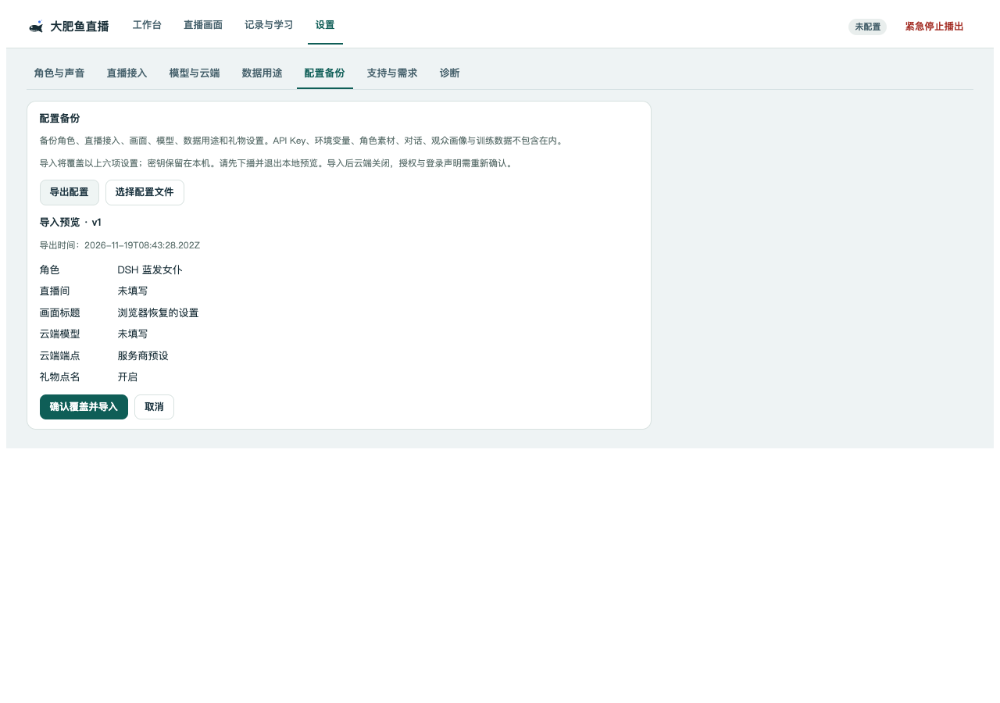

# DaFeiYu · Self-Learning AI Livestream Plugin

[简体中文](README.md) | [English](README.en.md)

A local-first livestream console for [DeepSeek Harness](https://github.com/deepseek-ai/deepseek-harness). Manage characters, read Douyin live interactions, generate and broadcast replies, and govern memory, skills and training through auditable controls.

Package: `dsh-dafeiyu-evolve` · Version: **0.20.0** · Declared host compatibility: **0.2.2-rc.1**

[Feature wall](https://github.com/jianwuzhao/streamer/issues) · [Changelog](CHANGELOG.md) · [Sponsor](#sponsor)

## Features

| Area | Available capabilities |
| --- | --- |
| Workbench | Character preview, text/voice trials, live comments and gifts, manual or event-based automatic replies, usage costs |
| Characters and output | Blue-haired maid, four character profiles and a Xiaxia rigged-avatar prototype; lip sync, blinking, dialogue motion; macOS broadcast window and subtitles |
| Models | Local-first Ollama, model setup, DeepSeek/Hunyuan/custom OpenAI-compatible endpoints, connection tests, key management and quota queries |
| Live integration | Douyin room browser reader or an authorized relay; authentication and streaming remain in the official streaming client |
| Learning governance | Unified memory, skills, corrections, audience profiles, gift ledger, training gates, release validation and rollback |
| Configuration backup | JSON export, import preview, explicit replacement, validation and transactional rollback for six settings sections |

Training, model promotion and consolidation have admission gates. A dry run is not represented as actual training or a successful platform broadcast. Emergency stop switches to a safe scene; pausing learning is a separate control.

## Install

Use a prebuilt `.tgz` from [GitHub Releases](https://github.com/jianwuzhao/streamer/releases) to avoid compiling during installation. Community market listings require approval by catalog maintainers; a submission does not mean the plugin is already listed.

- **DSH Desktop:** open **Plugins**, install the release archive or its URL, and enable the plugin. Open the **大肥鱼** entry. Installing into a separate `web` profile does not install it into Desktop.
- **dsh web:** substitute your actual profile below, then follow the host's refresh/restart instructions.

```bash
dsh plugin --profile <profile> add https://github.com/jianwuzhao/streamer/releases/download/v0.20.0/dsh-dafeiyu-evolve-0.20.0.tgz
```

For development, use Node.js **≥22.13.0** and pnpm. Building the native macOS output window also requires Xcode Command Line Tools.

```bash
git clone https://github.com/jianwuzhao/streamer.git
cd streamer
pnpm install --frozen-lockfile
pnpm typecheck
pnpm test
pnpm build
```

After building, install the local bundle through the host's `plugin_manager install_bundle <absolute-repository-path>`. The repository does not track `lib/`; a source checkout needs a build before installation. Prefer the release archive.

## First run

1. Open **Settings → Character and voice** (角色与声音), select a character, try its voice and confirm your rights to use the assets.
2. In **Models and cloud** (模型与云端), deploy Ollama or enter your cloud endpoint, model and API key. Test the connection before saving. Environment variables take priority over panel settings.
3. In **Live integration** (直播接入), enter a `https://live.douyin.com/…` room URL and configure the browser reader or relay. Complete account authentication and login in the official client.
4. Confirm data use and try a local preview first. On macOS, open the output window and capture it in the official streaming client, with one character audio track.
5. Request a broadcast after preflight checks pass. The console stays in an awaiting-confirmation state until platform confirmation. Stop the broadcast when finished; use **Emergency stop** for faults.

The current console labels are Chinese. Detailed operational documentation and environment variables are available in the [Chinese quick start](docs/quick-start.md) and [configuration reference](docs/implementation-status.md#环境变量).

Lythri 4B-A2B, Lythri 7B-A4B and Baby Boon 1.7B can be deployed as text reply models. DuplexJev connects through a local gateway for WAV-based turn tests. The model page and the [model comparison guide](docs/model-comparison.md) list performance figures, strengths and limitations.



## Import and export configuration

Open **Settings → Configuration backup** (设置 → 配置备份).

- **Export configuration** (导出配置) downloads versioned JSON with an export timestamp. It includes character, platform, scene, cloud model, data-use and gift settings.
- **Choose configuration file** (选择配置文件) validates it and displays a summary. **Confirm replacement and import** (确认覆盖并导入) replaces all six sections; it does not merge them. Export your current settings first if you want an easy way back.
- Only this plugin's v1 backup format is accepted, up to 128 KiB. Unsupported versions, missing sections, unknown fields and invalid values are rejected. A write failure rolls back both settings and audit entries.
- API keys, environment variables, SQLite data, audience profiles, conversations, memory, training history, model weights and character assets are excluded. Existing local keys remain untouched; environment overrides still apply.
- Stop broadcasting and exit local preview before importing. Afterwards, reconfirm asset rights, platform login and data use. Cloud access is disabled until you inspect the endpoint, test the connection and enable it again.

Backups still contain room URLs, custom endpoints and user-entered text. Store them privately and inspect them before attaching them to a public issue. A full migration also needs a separate copy of your data directory and appropriately licensed assets.

## Feature wall

[Browse requests and issues](https://github.com/jianwuzhao/streamer/issues) · [Request a feature](https://github.com/jianwuzhao/streamer/issues/new?template=feature_request.yml) · [Report a bug](https://github.com/jianwuzhao/streamer/issues/new?template=bug_report.yml)

Chinese and English submissions are welcome. Describe your use case, the current obstacle, the desired interaction and observable acceptance criteria. Search first and discuss matching requests in the existing issue. Open issues are proposals or ongoing work; see the maintainer's closing explanation for outcomes. There is no guaranteed schedule. See [Contributing](CONTRIBUTING.md).

## Sponsor

If this project saves you setup or debugging time, you can buy the author a coffee to support maintenance, testing and documentation.

These are the same author's public sponsorship codes from [DaFeiYu Assistant](https://github.com/jianwuzhao/dsh_pet_flutter#赞助), referenced directly from that repository.

| Alipay | WeChat Pay |
| :---: | :---: |
|  |  |

Sponsorship is voluntary. It does not purchase features, priority handling or commercial rights to assets. Bug reports, translations, reproductions and code contributions are also welcome.

## Support and limitations

- Declared host compatibility is `0.2.2-rc.1`; other versions need verification. DSH may introduce breaking changes.
- macOS is the current development platform. The native output window requires macOS 13+. Windows/Linux GPU, audio capture and official streaming-client workflows need device testing.
- Cloud providers may charge fees. Local performance depends on the model and hardware. RTX 4060 Ti 8GB / 32GB RAM is a target configuration with parameters still requiring measurement.
- Real QLoRA training, long livestream sessions, platform permissions and stream quality need target-device validation. Automated tests do not establish those results.
- Character assets, voices and models have separate rights. Local characters and weights under `data/` are not included in releases; available fallback visuals are used when assets are missing.

## Development and documentation

[Documentation index](docs/README.md) · [Architecture and implementation status](docs/implementation-status.md) · [Changelog](CHANGELOG.md) · [Release procedure](docs/releases/README.md)

```bash
pnpm typecheck
pnpm test
pnpm test:worker
pnpm build
```

Production code is in `src/`, the single-file host interface is `client/client.js`, and the default runtime configuration is `config/default.yaml`. Runtime data defaults to `data/`, overridable through `DAFEIYU_DATA_DIR`.

## Licensing and acknowledgments

The project's own license has not yet been selected. Public source availability does not grant commercial-use or redistribution rights; contact the author through this repository for permission. Third-party components retain their own licenses regardless of sponsorship.

- [DeepSeek Harness](https://github.com/deepseek-ai/deepseek-harness): host platform.
- [dsh-pet](https://github.com/PC2005-cloud/dsh-pet): blue-haired maid animations, with their [MIT license](client/assets/dsh-pet/LICENSE) retained.
- three.js: its [MIT license](client/assets/rigged-avatar/LICENSE-three.txt) is included.
- Live2D Cubism Core, PixiJS and pixi-live2d-display: see [runtime notices](client/vendor/VENDOR-LICENSES.md).
- Eciyuan character information and assets belong to their respective rights holders. Locally held assets do not imply permission for redistribution or commercial use.
