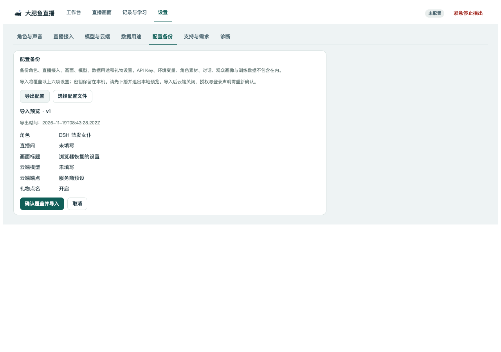

# 大肥鱼 · AI 自学习直播插件

[简体中文](README.md) | [English](README.en.md)

面向 [DeepSeek Harness](https://github.com/deepseek-ai/deepseek-harness) 的本地优先直播控制台。管理角色、接收抖音直播互动、生成与播出回复，并在可审计的边界内管理记忆、技能和训练。

包名：`dsh-dafeiyu-evolve` · 当前版本：**0.20.0** · 已声明兼容宿主：**0.2.2-rc.1**

[快速开始](docs/quick-start.md) · [需求墙](https://github.com/jianwuzhao/streamer/issues) · [更新记录](CHANGELOG.md) · [赞助](#赞助)

## 功能

| 功能 | 当前能力 |
| --- | --- |
| 工作台 | 角色预览、文字/语音试听、弹幕与礼物等互动、手动或按类型自动回复、费用记录 |
| 角色与播出 | 蓝发女仆桌宠、四份角色档案、夏夏三维骨骼样板；口型、眨眼、对话动作；macOS 独立播出窗口与字幕 |
| 模型 | Ollama 本地优先；一键部署本地模型；DeepSeek、混元及自定义 OpenAI 兼容云端，连接测试、密钥维护与额度查询 |
| 直播接入 | 抖音直播间浏览器读取或授权转发源；推流与账号认证由官方直播伴侣完成 |
| 学习治理 | 统一记忆、技能库、反馈纠错、观众画像、礼物账本、训练门禁、版本验证与回滚 |
| 配置备份 | 六类面板设置 JSON 导出、导入预览、确认覆盖、校验与事务回滚 |

训练、模型晋级和固化均有准入条件；不会把测试演练当成真实训练或平台开播成功。紧急停止立即切安全画面，与暂停学习分别控制。

## 安装

推荐使用 [GitHub Releases](https://github.com/jianwuzhao/streamer/releases) 中的预构建 `.tgz`，无需在安装时编译。dsh 社区市场收录由目录维护者审核，提交不代表已上架。

- **DSH 桌面版**：打开「插件」安装发行包或发行包 URL，启用插件；入口为「大肥鱼」。不要向另一个 `web` profile 安装后期待它出现在桌面版。
- **dsh web**：将 `<profile>` 换为实际使用的配置名称，安装后按宿主提示刷新或重启。

```bash
dsh plugin --profile <profile> add https://github.com/jianwuzhao/streamer/releases/download/v0.20.0/dsh-dafeiyu-evolve-0.20.0.tgz
```

源码开发：Node.js **≥22.13.0**、pnpm；macOS 构建原生播出窗口需 Xcode 命令行工具。

```bash
git clone https://github.com/jianwuzhao/streamer.git
cd streamer
pnpm install --frozen-lockfile
pnpm typecheck
pnpm test
pnpm build
```

构建后可通过宿主 `plugin_manager install_bundle <仓库绝对路径>` 安装本地包。源码仓库不跟踪 `lib/`，直接安装 GitHub 源码前必须构建；优先使用发行包。

## 第一次使用

1. 打开「设置 → 角色与声音」，选择角色、试听并确认素材使用授权。
2. 在「模型与云端」部署 Ollama 本地模型，或填写云端端点、模型和 API Key，测试成功后保存。环境变量优先于面板设置。
3. 在「直播接入」填写 `https://live.douyin.com/…` 房间链接，按所用来源配置浏览器或转发源；在官方客户端完成账号认证与登录。
4. 确认数据用途，在工作台先做本地预览。macOS 可打开独立播出窗口，通过直播伴侣采集画面与一条角色音轨。
5. 自检通过后申请开播；平台未确认时只显示等待确认。结束时下播，异常时使用「紧急停止」。

完整流程与环境变量见 [快速开始](docs/quick-start.md) 和 [配置参考](docs/implementation-status.md#环境变量)。



## 配置导入与导出

入口：**设置 → 配置备份**。

- 点击「导出配置」，下载带格式版本和导出时间的 JSON 文件。包含角色、直播接入、画面、云端模型、数据用途、礼物六项面板设置。
- 点击「选择配置文件」，校验后查看摘要，再点击「确认覆盖并导入」。导入为整组覆盖，不是合并；请先导出当前配置以便恢复。
- 只接受本插件 v1 格式，最大 128 KiB；未知字段、非法值、缺失节与不支持的版本会被拒绝，写入失败则连同审计一起回滚。
- API Key、环境变量、SQLite 数据、观众画像、对话/记忆/训练记录、模型权重和角色素材不随备份迁移。本机现有密钥保留；环境变量仍优先。
- 必须先下播并退出预览。导入后需重新确认素材授权、平台登录、数据用途；云端默认关闭，检查端点并测试连接后再启用。

备份仍含房间地址、自定义端点和个人填写内容，请自行保管，提交问题时不要附上未经检查的原文件。完整迁机还需单独迁移数据目录与合法取得的素材。

## 需求墙

[查看全部需求与问题](https://github.com/jianwuzhao/streamer/issues) · [提交需求](https://github.com/jianwuzhao/streamer/issues/new?template=feature_request.yml) · [报告故障](https://github.com/jianwuzhao/streamer/issues/new?template=bug_report.yml)

欢迎用中文或英文提交，写清「使用场景 → 当前困难 → 期望操作 → 验收方式」。提交前搜索已有条目；相同需求在原条目讨论。Issue 打开表示待讨论或处理中，关闭原因以维护者回复为准；不承诺排期，也不把未实现的愿望写成已有功能。详见 [参与方式 / Contributing](CONTRIBUTING.md)。

## 赞助

如果项目帮你减少了搭建和调试时间，欢迎请作者喝杯咖啡，支持维护、测试与文档工作。

赞助入口沿用同一作者的 [大肥鱼助手](https://github.com/jianwuzhao/dsh_pet_flutter#赞助)；以下二维码直接引用该项目公开的赞助图片。

| 支付宝 | 微信 |
| :---: | :---: |
|  |  |

赞助完全自愿，不购买功能、优先处理权或商业素材授权。也欢迎提交问题、完善翻译、复现故障与贡献代码。

## 支持范围与限制

- 已声明宿主兼容版本为 `0.2.2-rc.1`；其它版本需要另行验证，DSH 仍可能有兼容性变更。
- macOS 为当前开发环境，独立原生播出窗口要求 macOS 13+；Windows/Linux 的 GPU、声音采集与直播伴侣工作流须实机验收。
- 云端调用可能产生服务商费用；本地推理性能取决于模型与硬件。RTX 4060 Ti 8GB / 32GB 是目标配置，参数仍需实测。
- QLoRA 训练、长时间直播、真实平台权限与推流效果需在目标机验证。自动化测试通过不代表这些环节已经验收。
- 角色素材、语音和模型需要各自授权。`data/` 中的本地角色与权重不随发行包提供；缺失时使用可用的回退形象。

## 文档与开发

[文档索引](docs/README.md) · [实现状态与架构](docs/implementation-status.md) · [更新记录](CHANGELOG.md) · [发行流程](docs/releases/README.md)

```bash
pnpm typecheck
pnpm test
pnpm test:worker
pnpm build
```

生产代码位于 `src/`，单文件宿主界面位于 `client/client.js`，默认运行配置位于 `config/default.yaml`。运行数据默认保存在 `data/`，可用 `DAFEIYU_DATA_DIR` 覆盖。

## 许可与致谢

本项目自身的许可证尚未确定；公开代码不代表授予商业使用或再分发许可，需要授权请通过仓库联系作者。第三方组件继续遵循其原许可，不受赞助影响。

- [DeepSeek Harness](https://github.com/deepseek-ai/deepseek-harness)：宿主平台。
- [dsh-pet](https://github.com/PC2005-cloud/dsh-pet)：蓝发女仆动画，随包保留 [MIT 许可证](client/assets/dsh-pet/LICENSE)。
- three.js：随包保留 [MIT 许可证](client/assets/rigged-avatar/LICENSE-three.txt)。
- Live2D Cubism Core、PixiJS 与 pixi-live2d-display：见 [第三方运行时说明](client/vendor/VENDOR-LICENSES.md)。
- 鹅次元角色资料与素材来自原权利人；个人本地素材不代表可公开再分发或商业使用。
