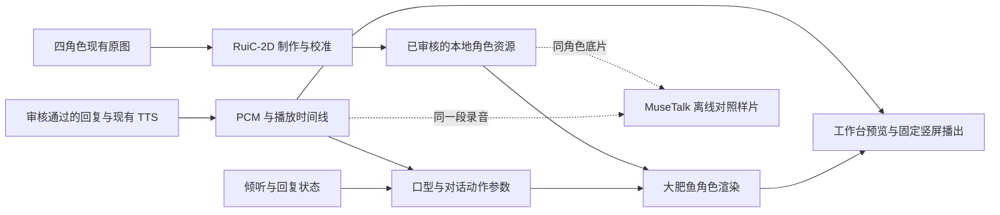

# 四角色直播形象重构方案 · RuiC-2D × LiveTalking

采用 **RuiC-2D 的角色制作能力与 LiveTalking 的流式调度思路**，由大肥鱼统一驱动和播出。RuiC-2D 负责角色分层、表情差分与网格绑定。LiveTalking 提供音频分块、音画配对、可打断播报及静音时切换动作的参考。默认实播路径是固定 9∶16 的本地 2D 渲染，神经口型先用 MuseTalk 做离线对照。以夏夏验证观感和播放链路，随后制作沈露白、谷雨、贝拉。四个角色分别保留各自的原图、五官特征、发型和饰品。

本方案基于两套上游的 `main` 源码和当前大肥鱼代码。本地四张原图均为 768×1080，符合 RuiC-2D 的导入范围。分层质量、Mac 播出容器兼容性及直播伴侣采集效果需要用四个角色实测。 [RuiC-2D 导入说明](https://github.com/HRuiCcc/RuiC-2D#从新图制作) · [LiveTalking 架构](https://github.com/lipku/LiveTalking#3-系统架构)

## 哪些能力值得引入

| 现有问题 | RuiC-2D 可提供 | 大肥鱼需要补齐 |
| --- | --- | --- |
| 闭眼时睫毛和眼皮像被压成一条线，张口时唇缘和口腔质感偏生硬 | 配准导入闭眼、半闭眼及多种口型差分，让纹理随同一网格移动 | 按角色制作真实光影一致的差分，补全闭唇、圆唇、横展、露齿和自然微笑。做闭口、眼角和嘴角的过渡检查 |
| 头、肩、头发和饰品缺少层次 | 独立图层、权重、附属部件摆动，允许手工修正 | 细分刘海、后发和配饰，补绘轻微移动露出的区域。背景单独合成，头颈连续。夏夏的耳麦与头部绑定，耳饰等软部件按角色校准 |
| 倾听容易显得在待机 | 眼睛开度、视线、眉毛、头肩参数和可编辑动作 | 按对话阶段安排抬眼、点头、表情转变。动作由输入开始、思考、回复起止等事件触发，眨眼和呼吸只做自然补充 |
| 按音量动嘴，声音有了却看不出在发哪个音 | 可外部设置开口与口形参数，也可使用已有口型纹理 | 发音时间线单独建设。上游默认配音以音量驱动开合，并随时间变化口形，不能直接用于音素级对齐 |

[上游配准与蒙版实现](https://github.com/HRuiCcc/RuiC-2D/blob/main/tools/art.py) · [网格播放器及差分实现](https://github.com/HRuiCcc/RuiC-2D/blob/main/public/vendor/mesh-avatar.js) · [上游配音及捕捉逻辑](https://github.com/HRuiCcc/RuiC-2D/blob/main/public/app.js#L100-L106)

单张图的遮挡区域需要人工补绘或经复核的差分。沈露白、贝拉等原姿态已有偏转，应沿其原角度制作左右眼和口型差分，分别限制转头范围。自动分层适合作为初稿，最终以刘海边缘、耳饰、耳麦、颈肩以及遮挡处的实际运动为准。 [上游单图制作限制](https://github.com/HRuiCcc/RuiC-2D#验证与限制)

上游本地补绘也采用图像修复、线条和椭圆来画眼皮与口腔，可用来检查绑定和切换逻辑。样片的质量验收应使用逐角色精修的差分，否则容易重现当前眼皮和口腔生硬的问题。 [上游本地补绘源码](https://github.com/HRuiCcc/RuiC-2D/blob/main/tools/art.py#L56-L79)

## LiveTalking 的合并范围

| 借用的能力 | 大肥鱼的落点 |
| --- | --- |
| 按音频区间提取特征，将推理结果和对应音频一起交给输出 | 在已安排播放的 PCM 上记录采样区间，口型和声音通过同一时间线关联。允许实测后选择短前瞻，记录首音增加了多少等待 |
| 播报打断、状态事件和队列管理 | 借用会话隔离与队列清理思路。大肥鱼同时撤销已安排的音频、口型、字幕及可选推理结果，防止迟到帧恢复上一句 |
| 静音时跳过口型推理并使用预制动作 | 实播时按倾听、思考、说话、收尾触发同一套 2D 模型的动作。眼神、头肩和饰品延续此前姿态，过渡混合动作参数，避免整帧淡入造成嘴和眼重影 |
| 将发声、渲染和输出拆成独立模块 | 保留现有 Qwen 声线与固定播出窗口。口型时间线可替换，Pixi 与 MeshAvatar 吃同一组参数。可选视频渲染是独立的整段实验路径 |

LiveTalking 源码已将生成帧与对应音频一同入队，静音时可绕过推理，输出积压时会节流。其打断 API 处理音频队列，因此大肥鱼还需覆盖本机已调度播放与窗口内迟到帧。 [LiveTalking 渲染与队列源码](https://github.com/lipku/LiveTalking/blob/main/avatars/base_avatar.py#L171-L176) · [音画配对与输出](https://github.com/lipku/LiveTalking/blob/main/avatars/base_avatar.py#L330-L458) · [打断 API](https://github.com/lipku/LiveTalking/blob/main/docs/api.md#5-打断播报)

## 接入方式

1. **离线制作。** 在独立目录使用 RuiC-2D 工程做分层和素材校准，保留可编辑 `.yxavatar`。发布时由转换工具提取经过校验的 `rig.json`、`built/` 图层与差分元数据，打成大肥鱼的版本化资源。优先验证原始图层包，`.mavatar` 会合并部分细节层。制作工具使用 Python、OpenCV、Pillow、NumPy，上游配音导入用到 FFmpeg。这些仅用于制作工作站，直播加载已经构建的静态资源。 [上游导出与依赖说明](https://github.com/HRuiCcc/RuiC-2D#导出) · [播放器资源加载源码](https://github.com/HRuiCcc/RuiC-2D/blob/main/public/player.js)
2. **渲染适配。** 在 `client/client.js` 的共享角色入口增加薄适配，候选方案是固定版本的 MeshAvatar WebGL2 运行时，以 `createMeshAvatar` 的手动模式接收大肥鱼参数。先验证左右眼、`mouthForm` 的符号、运动缩放和资源销毁，并把自动待机和内部口型驱动的控制权交给大肥鱼。若同素材下现有 Pixi 足以呈现效果，或 MeshAvatar 在实际 `WKWebView` 容器中表现欠佳，则由 Pixi 加载同批校准素材。`src/avatar/model-store.ts` 校验资源版本、原图摘要、尺寸及白名单，四角色逐个开启，加载失败时回退当前模型。 [上游运行时 API](https://github.com/HRuiCcc/RuiC-2D/blob/main/public/vendor/mesh-avatar.js)
3. **音频和口型时间线。** 现有 `useRoleSpeech` 继续负责 PCM 排程和 `AudioContext` 播放。每段口型记录 `turnId`、`profileId`、采样率、起止采样位置与各口型权重。工作台按实际播放位置求值，独立窗口通过现有 SSE 收到带采样时刻和顺序号的姿态，按同一播放位置短插值，过期或跨话轮的样本直接丢弃。优先使用经核验的 TTS 发音时间戳。当前 Qwen 语音进程只发 PCM，先用人工标注录音验证渲染，再给现有 TTS 比较分句本地音频对齐与轻量声学估计。对齐就绪的口型做连读过渡，`b/p/m` 的闭唇覆盖呼吸余量。对齐结果未赶上播放时用音频估计并记录降级。额外等待计入首音预算。
4. **动作与打断。** 复用 `createAvatarMotion` 的眨眼和缓动，新增对话事件驱动。收到弹幕后短暂把视线移到互动区，语音输入时以开始或停顿为点头候选，等待回复时逐步转入思考，实际首音开始切到说话，尾音后收口并返回倾听。对连发弹幕合并动作并限制重触发频率。切角色、打断或紧急停止时递增本次播放版本并取消排程，SSE 与渲染器拒收旧版本。紧急停止立即切安全画面并静音。
5. **安全与输出。** `src/live/broadcast-window.ts` 继续提供本机鉴权与状态推送，AI 标识、回复审核和安全画面沿现有路径。直播伴侣采集现有固定竖屏窗口和单路角色音轨，普通使用无须另外安装摄像头驱动、MediaPipe、OBS、Python 编辑服务或 LiveTalking。制作时可选 MediaPipe 录制动作参考。 [RuiC-2D 许可](https://github.com/HRuiCcc/RuiC-2D/blob/main/LICENSE) · [MeshAvatar 许可](https://github.com/HRuiCcc/RuiC-2D/blob/main/public/vendor/LICENSE-mesh-avatar.txt)

## 神经口型实验与上线条件

- **首选做离线 MuseTalk 样片。** 由夏夏的新 2D 模型输出带轻微头部运动的同角色视频底片，再给 MuseTalk 输入与实时 2D 样片相同的 PCM。上游的 Avatar 准备接口以视频为输入，MuseTalk 的运行时还需预计算的潜变量、口部遮罩和坐标。对比唇色、牙齿、原貌、帧间抖动及口型准确度。2D 渲染和神经渲染各负责一条完整对照画面，避免两套嘴部形变同时作用。 [Avatar 生成接口](https://github.com/lipku/LiveTalking/blob/main/docs/avatar_api.md) · [MuseTalk 接入源码](https://github.com/lipku/LiveTalking/blob/main/avatars/musetalk_avatar.py) · [MuseTalk 原貌与抖动限制](https://github.com/TMElyralab/MuseTalk#limitations)
- **Mac 实时能力实测后决定。** LiveTalking 有 MPS/CPU 设备选择，官方安装验证和公开性能数据主要来自 Ubuntu/CUDA 与 RTX。其当前默认批量和音频上下文参数以自身运行环境为基准。实验记录预处理、音频前瞻、推理和合成耗时，先验证能否稳定跑通，再在目标机上分别评估较小批量、预热和显存／内存负载。Ultralight 接入要求现成的角色专用权重、裁脸帧和坐标，四张原图无法直接提供这些资产。 [设备选择源码](https://github.com/lipku/LiveTalking/blob/main/utils/device.py) · [上游性能](https://github.com/lipku/LiveTalking#6-性能指标) · [Ultralight 资源要求](https://github.com/lipku/LiveTalking/blob/main/avatars/ultralight_avatar.py#L58-L75)
- **实时视频路径独立验收。** 若离线对照在口型和原貌上优于 2D，再评估本机可选的实时视频渲染。启用后由同一渲染会话提供成对音画，独立播出窗口内只有一个声音来源。完整音频上传接口只用于文件实验，真正实时接入须验证分块 PCM、时间戳、播放缓冲和取消。切换渲染后端只在句间进行，异常时先停止旧会话及旧音轨，再回到 2D 或安全画面。WebRTC 只在可选路径需要进程间传视频时评估，须验证实际缓冲和断线行为。 [LiveTalking 文件音频与 WebRTC 接口](https://github.com/lipku/LiveTalking/blob/main/docs/api.md)
- **许可按组件核对。** LiveTalking 仓库标注 Apache-2.0，README 对公开发布视频另有水印和标识说明，当前渲染源码也会绘制标识。直接集成代码或发布其输出前，核对所选版本的标识要求，并分别确认模型权重、依赖和角色素材的使用权。MuseTalk 官方说明本项目权重可商用，第三方依赖和测试素材各按其条款。官方 Wav2Lip 公布的版本限个人、研究或非商业用途。RuiC-2D 的示例角色、差分和配音同样有单独许可，方案使用具备对应权利的四角色素材。 [LiveTalking 许可证](https://github.com/lipku/LiveTalking/blob/main/LICENSE) · [LiveTalking 声明](https://github.com/lipku/LiveTalking#8-声明) · [MuseTalk 授权](https://github.com/TMElyralab/MuseTalk#disclaimerlicense) · [Wav2Lip 授权](https://github.com/Rudrabha/Wav2Lip#please-check-the-evaluation-folder-for-the-instructions-license-and-citation) · [RuiC-2D 素材声明](https://github.com/HRuiCcc/RuiC-2D#开源协议)

## 实施和验收顺序

| 阶段 | 交付与验收 |
| --- | --- |
| 1. 夏夏观感样片 | 使用同一原图、录音和镜头，对照现版、Pixi 加新差分、MeshAvatar 加同批差分。再用人工标注发音时间线判断准确口型带来的独立增益。交付可播放的对照样片，检查原貌、眼皮、口腔、背景、耳麦跟随和倾听转说话。实际打开 `WKWebView` 播出窗口验证透明合成。若两套渲染观感接近，选维护成本较低的一套。 |
| 2. 音频调度和互动 | 录制直播伴侣最终画面与实际音轨，标注闭唇、元音开合与句尾，报告有符号偏移、绝对误差 P95 和最大值及测量误差。以 **≤80ms** 为项目验收线。分别记录从提问结束到审核完成、收到首段 PCM、实际首音的耗时，首音目标 **1–2 秒**。验证连续打断、TTS 迟到、网络断连和角色切换。 |
| 3. 神经口型对照 | 用相同夏夏底片与录音做 MuseTalk 样片，按原貌、口型、连续性和耗时对比。此项可并行开展，默认 2D 版本按前两阶段结果继续推进。可选实时路径只有在目标环境和最终采集均达标后才进入播出测试。 |
| 4. 四角色与播出回归 | 逐个校准沈露白、谷雨、贝拉，与夏夏一起验收静态外貌和对话动作。用目标 Mac 做固定 9∶16 长时采集，记录帧时间、丢帧、内存趋势，覆盖工作台后台、故障回退和安全场景。LMD、SyncNet 在固定参考片段、裁切、帧率、归一化规则后单独评测。 |

现有项目记录的 **19ms** 是合成动作样本上传到渲染回调的 P95，只用于比较应用内部链路。原型成功的判据是同条件对照中能看见表情、口型和倾听的改善，以及目标机器上的实际播出录像通过验收。 [现有验证记录](avatar-motion-validation.md)
